начинаем первую (вторую) лабораторную работу


# Часть 0 - сервис

Api был написан на языке go и имеет три эндпоинта согласно требованиям

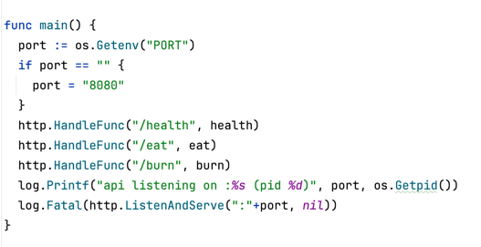

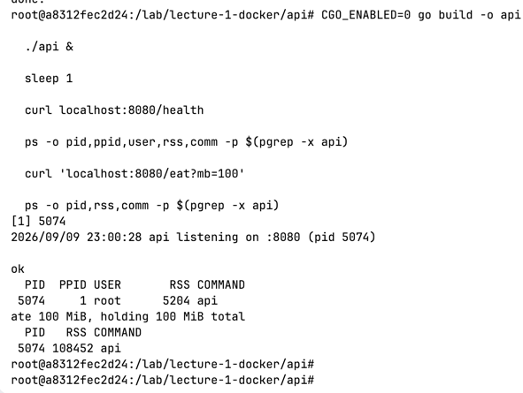

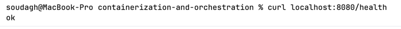

# Часть 1 - запуск без изоляции

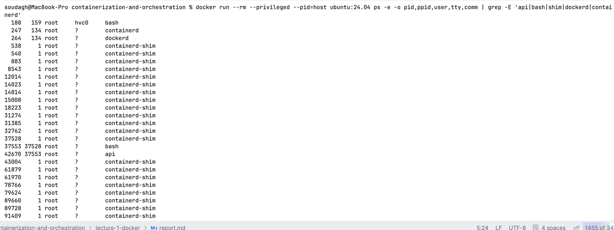

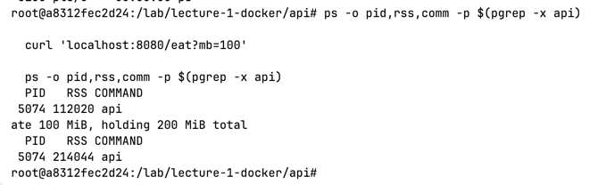

# Часть 2 - namespaces

Теперь пытаемся изолировать окружение нашего приложения, чтобы оно жило в своей песочнице ело свой песок выданными лопаточками и не высовывалось

Для этого необходимо сделать namespace - процесс останется обычным процессом того же ядра, но ядро будет показывать ему свою копию таблицы процессов, сетевого стека, хостнейм и т.д. при этом без виртуализации

Для начала нужно запустить утилитку unshare, но важно сделать это не от рута, так как рут внутри отобразится на рут снаружи. Поэтому я в контейнере сделаю обычного юзера и внутри него уже запущу

```bash
useradd -m student
cp /lab/lecture-1-docker/api/api /home/student/ && chown student /home/student/api
su - student
```

далее составляем unshare:

```bash
unshare --pid --fork --user --map-root-user --net --uts --mount --ipc --mount-proc bash
```

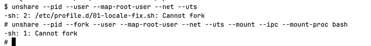

сначала вписала команду без форка и словила проблемку, фиксится просто выходом из сессии. А проблема заключалась в том, что unshare создал новые неймспейсы и через exec заменил себя на оболочку sh, которая осталась в старом pid неймспейсе. Далее дочерний процесс делает форк и становится pid 1 нового неймспейса, делает скрипт и завершается. но так как pid 1 умирает, ядро помечает его мёртвым и форк более невозможен, поэтому нормальная команда и не проходила.

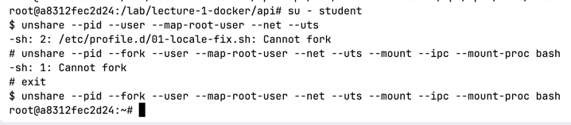

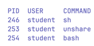

и следовательно получившиеся параметры

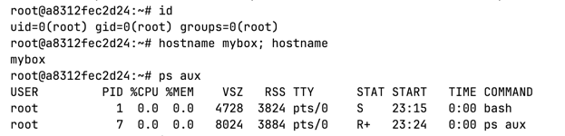

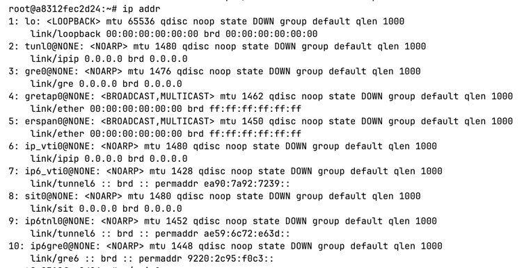

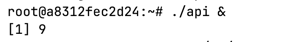

агент предлагает затестить подключение через локалхост

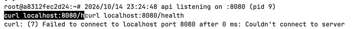

но оно не работает,потому что в новом network namespace есть только loopback lo, который выключен

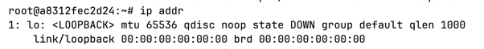

так что поднимаем его и тестим курл снова

```bash
ip link set lo up
```

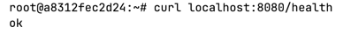

теперь смотрим снаружи

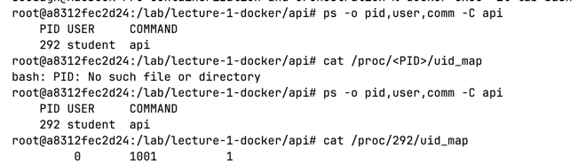

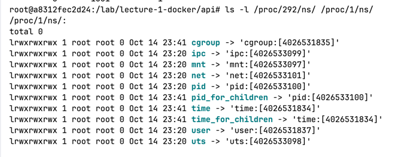

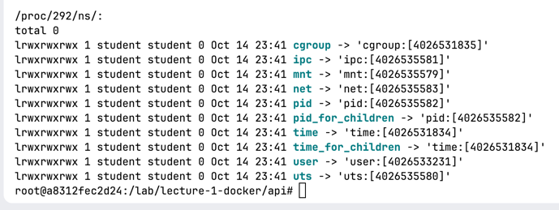

ну и видим, что снаружи у нас student с обычным pid, а внутри - рут со своим pid. При этом и своя сеть и свой хостнейм

# Часть 3 - cgroups v2

Если неймспейсы отвечают на вопрос "что процесс видит", то cgroups "сколько процесс может взять". Это два независимых механизма ядра, которые контейнер как раз комбинирует

управляются группы через файловую систему `/sys/fs/cgroup`

```bash
mkdir /sys/fs/cgroup/mydocker
echo 292 > /sys/fs/cgroup/mydocker/cgroup.procs
cat /proc/292/cgroup
```

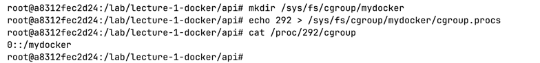

далее проверяем работу наших групп по примеру памяти, цпу и процессов

```bash
cd /sys/fs/cgroup/mydocker
echo 150M > memory.max
echo 0    > memory.swap.max
cat memory.max memory.swap.max
```

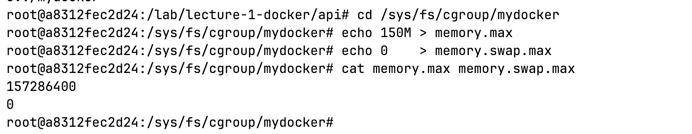

теперь заставляю api съедать память

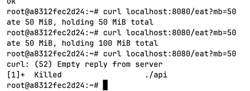

видно, что ограничение сработало как надо и на второй добавке наш сервис наелся и лёг спать (умер (убили))

видим ивент на oom_kill и что процесс мёртв

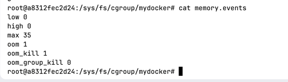

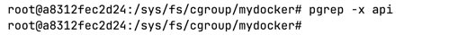

дальше смотрим cpu, сначала рестартим сервис, новый PID - 357, проставляем его в сигруппы

```bash
echo 357 > /sys/fs/cgroup/mydocker/cgroups.procs
```

ловлю пермишен денайд потому что файл называется `cgroup.procs`

```bash
echo 357 > /sys/fs/cgroup/mydocker/cgroup.procs
```

ставим ограничение в полядра на 100мс

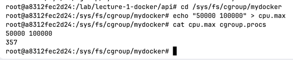

пытаемся прогнать бёрн, на что получаем ответ, что 1 ядро занято

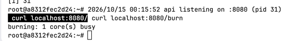

теперь смотрим снаружи:

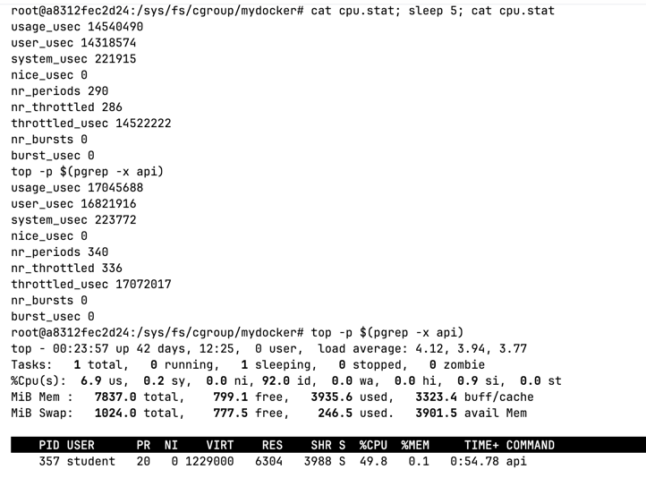

видим, что дельта между новыми и старыми nr_periods и nr_throttled = 50 периодов, а usage_usec и user_usec ~2.5 секунд соответственно за пятисекундный промежуток. + максимальное значение нагрузки CPU 50%. Как видим - процесс живой и продолжает работать, просто в ограниченном формате.

приступаем к процессам:

проставим максимум 20 процессов + снимем ограничение с цпу, чтобы не мешало

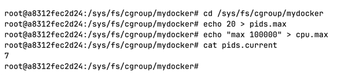

переносим всё в отдельную оболочку и делаем ФОРК-БОМБУ

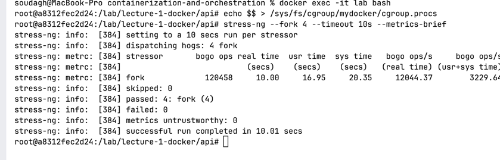

смотрим на количество процессов и видим, что их стало ооочень много и отказов 149113

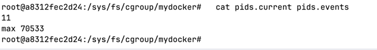

честно я вот проследовала инструкциям и командам агента, но так и не поняла, почему эта цифра должна мне дать какое-то понимание о том, что проблема была в процессах. При этом в терминале, где была ФОРК БОМБА тоже ошибок нет. Пришлось воспользоваться имба промптом для разъяснения ситуации


для наглядности того, что мы упираемся именно в ограничение по процессам -

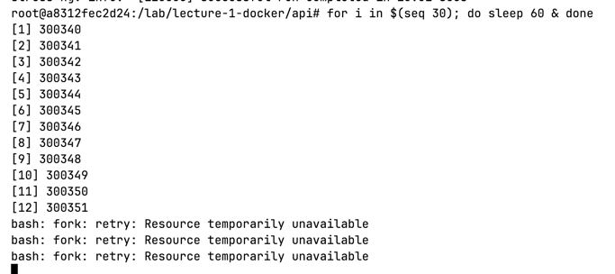

# Часть 4 - привилегии

## capabilities

Какие привилегированные действия нам разрешены?

так получилось, что date -s не подойдёт для демонстрации - оно упадёт со всеми capabilities с невозможностью совершить операцию, так как время не изолированный ресурс

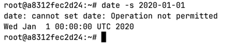

Поэтому я сделаю другое, а именно работу с сетью, которая была у нас во второй части - `ip link set lo up`, которая будет ограничиваться при помощи `CAP_NET_ADMIN`

Глянем, что есть сейчас в нашем неймспейсе

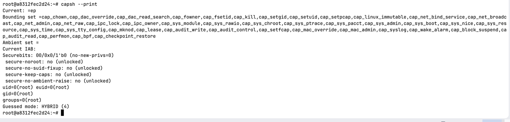

перед всем действием видим, что наш lo поднят и в здравии, попытаемся сейчас его положить для чистоты эксперимента

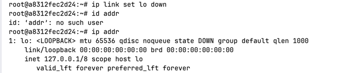

видим, что он упал, теперь навешиваем ограничения и пытаемся снова поднять

```bash
capsh --drop=CAP_NET_ADMIN -- -c "ip link set lo up"
```

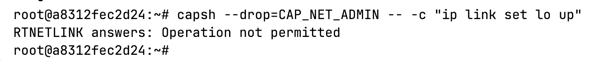

Столкнулись с закономерной ошибкой

## seccomp

Какие системные вызовы может делать процесс?

для начала составлю json с денайлистом - перечисление коллов, которые нельзя будет вызвать

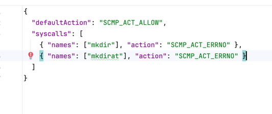

теперь проверяем команды

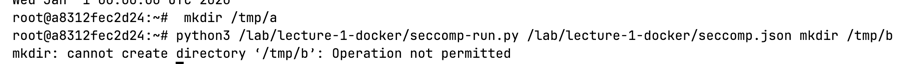

без фильтра директория создаётся, с фильтром - ошибка

как выглядит фильтрация со стороны ядра - видим, что перешло в filter mode с одним фильтром:

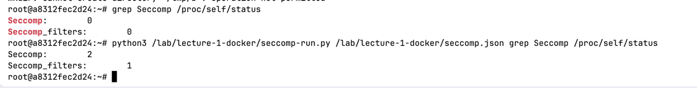

при попытке покидать курлы на свой апи сервис я увидела невероятное залипание. Оказывается я забыла поднять lo

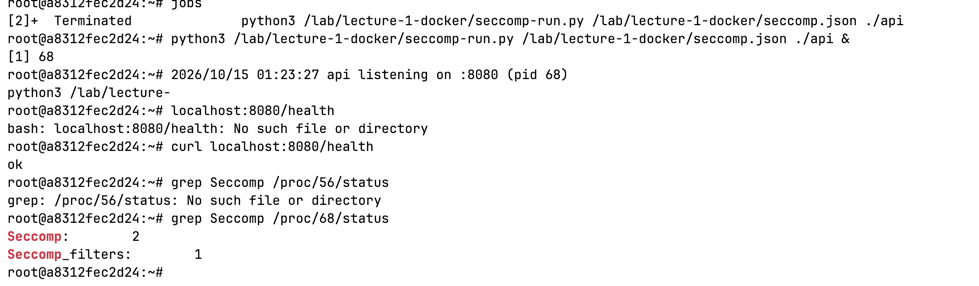

и в общем видим, что фильтры также унаследовались и дочерним процессом

# Часть 5 - свой Docker

## 5a - порядок действий

Сейчас все действия из прошлых частей надо собрать в одну команду, которая будет изолированно запускать приложение, то есть будем реализовывать runc руками

сначала выполняем самые привилегированные действия и движемся к самым ограниченным

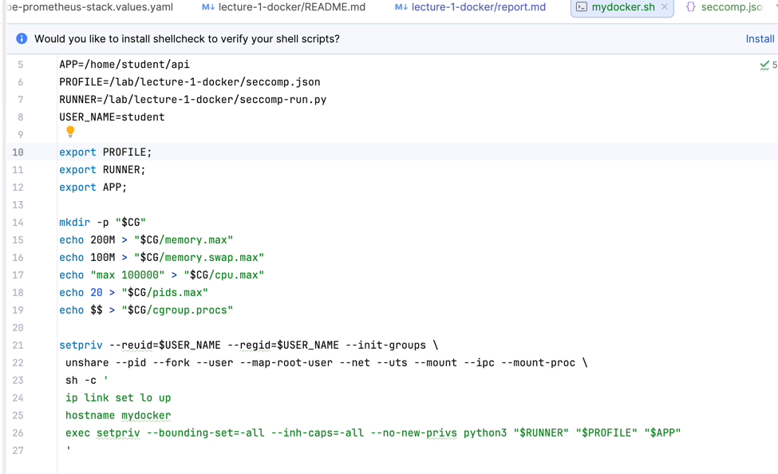

и пытаюсь запустить из скрипта

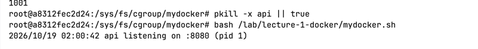

теперь проверяем все наши параметры:

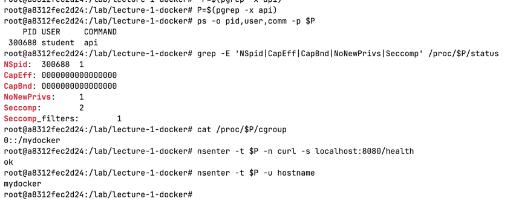

как видим, из одного нашего файла, который составлен из цепочки баш-команд нам получилось завести все предыдущие части нашей работы

## 5б - сравнение с docker run

для начала надо запустить docker run ровно с теми флагами, которые соответствуют нашему скрипту

```bash
docker run --memory=200M --memory-swap=300M --pids-limit=20 --cap-drop=all --security-opt=no-new-privileges --security-opt seccomp=./lecture-1-docker/seccomp.json --hostname=mydocker --user=1001:1001 -d --name api-docker -p 8081:8080 -v ./lecture-1-docker/api/api:/api:ro ubuntu:24.04 /api
```

запускаем команду и проверяем живость:

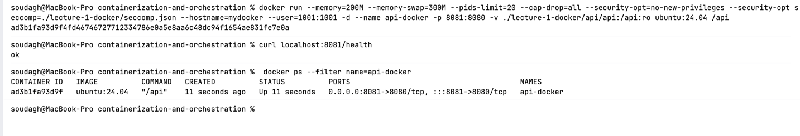

и, если сравнивать параметры, то выходит такая табличка:

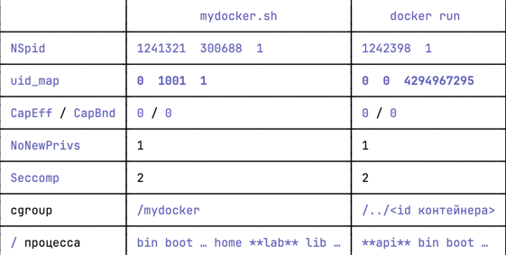

То есть всё совпадает за исключением нюансов, которые завязаны именно на внутренней реализации докера, и на том, что пока что собственный скрипт недостаточно секьюрный.

# Часть 6 - образы

mydocker.sh не хватает своей файловой системы, для этого нужен образ и метаданные. Во второй лабе я делала multi-stage образ, сейчас напишу как single, так и multi-stage, а потом сравню их

## Dockerfile + multi-stage

Single:

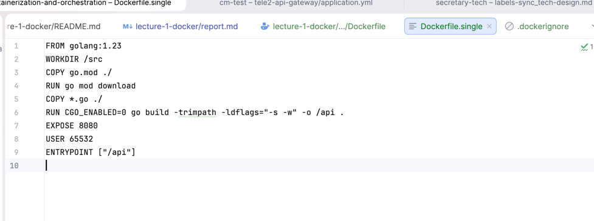

Multi-stage:

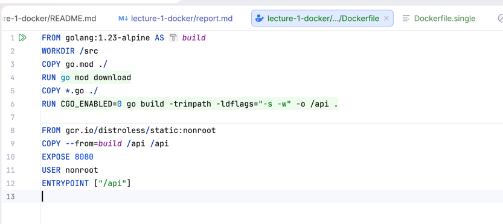

Теперь собираю образы:

```bash
docker build -f lecture-1-docker/api/Dockerfile.single -t api1:single lecture-1-docker/api
docker build -t api1:multi lecture-1-docker/api
docker images | grep api1
docker history api1:single
docker history api1:multi
```

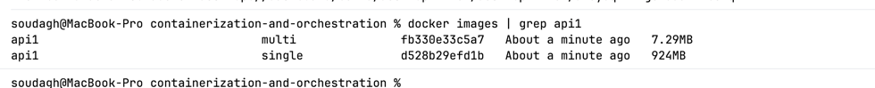

видно, что у обоих образов создалась файловая система

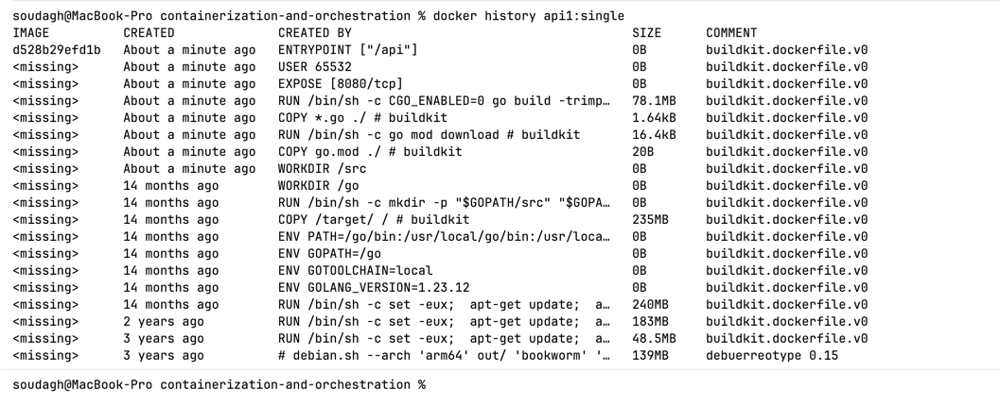

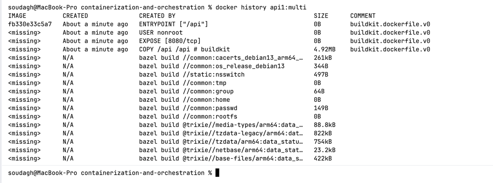

## Сравнение

Для начала можно заметить разницу в размерах - single-образ весит 924 МБ, когда же multi-stage - 7.29 МБ. Разница в 127 раз и по большей части это из-за отличия в образах - single тащит весь golang:1.23, чтобы собрать программу (около 845 МБ) + 78 МБ для слоя go build - сам бинарь размером 4.92 МБ и 73 МБ - кэш сборки Go. И всё это записалось в слой. А у multi-stage история такая - бинарник размером 4.92 МБ и около 2.3 МБ занимает distroless. то есть ни оболочки, ни пакетного менеджера + весь этап build с компилятором в финальный образ не попадает, так как у докера он существует только во время сборки, что ещё и добавляет секьюрности для этого варианта, так как поверхность атаки меньше - нет sh, пакетного менеджера, компилятора, curl. Также образ golang:1.23-alpine подтянулся из кэша после выполнения второй лабы.

Теперь я поменяю содержимое файла main.go и пересоберу образы

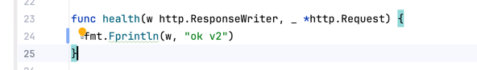

Single-образ:

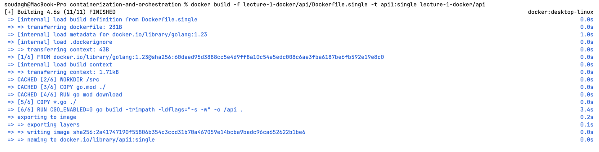

Из кэша подтягивается src, файл go.mod и его результат исполнения. Файл main.go, так как его хэш был изменён, поэтому шаг `COPY *.go` исполняется заново, а команды ниже по файлы выполняются заново, так как их родительский слой изменился.

Multi-stage-образ:

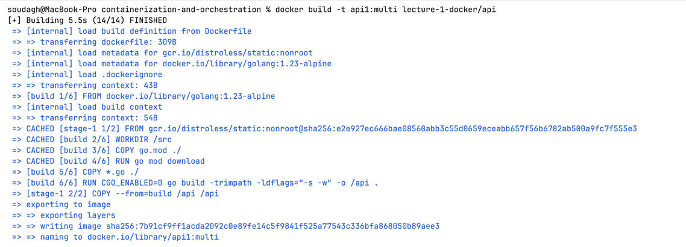

Ситуация абсолютно аналогична single-stage

## Volume

На примере со скрина можно заметить, что если мы закинем файл в контейнер, а потом контейнер удалим, то и файл удалится тоже.


Если же добавить том, то файл сохраняется туда и при рестартах контейнер его не теряет.

но во время попытки проверить этот кейс, я столкнулась с Permission Denied, так как точка монтирования не имела понятия какой владелец нам нужен

есть вариант запустить через рут, есть вариант перешить образ для подготовки точки монтирования с нужным владельцем - так и сделаем


Воспроизводим кейс и видим, что файл никуда не пропал


ну и как вишенка на торте - видим владельца (нашего!!)


Соответственно такое поведение происходит потому, что без volume файл записывается в верхний слой контейнера, и `docker rm` удалит его вместе с контейнером. С volume запись идёт в `/var/lib/docker/volumes/mydata/_data` на хосте - каталог смонтирован поверх overlayfs и живёт отдельно от контейнера.

# Часть 7 - gVisor

Все предыдущие части так или иначе были фильтрами вокруг одного общего ядра хоста, то есть одна уязвимость в ядре может вызвать побег из контейнера и, следовательно, доступ к машине. Это потому, что обычный контейнер всегда делит ядро с хостом. gVisor ставит между процессом и ядром Sentry - ядро в пространстве пользователя, написанное на Go.

Если вдаваться в подробности, то Gofer отдаёт Sentry файлы хоста, Sentry работает самостоятельно под жёстким ограничением seccomp с небольшим набором syscalls к хосту.


теперь сравним запуск просто внутри нашего контейнера, внутри любого другого контейнера, и нашего контейнера с gVisor:

Просто контейнер lab:


Рандомный тестовый контейнер:


lab с gVisor:


Видно, что при обычных вызовах в контейнере отвечает настоящее ядро хоста - отображается версия ядра и кольцевой буфер и как ядро регистрирует veth-интерфейсы других контейнеров. В gVisor на эти syscalls отвечает Sentry: он сам придумал версию 4.19, пишет шутки и ядро, по его логам, запущено "только что". Процесс не разговаривает с ядром хоста напрямую. Он разговаривает с ядром, написанным на Go и работающим в пространстве пользователя.

| | mydocker.sh | docker run | gVisor |
|---|---|---|---|
| кто обрабатывает syscalls | ядро хоста | ядро хоста | Sentry (ядро в userspace) |
| user namespace | есть: root внутри = `student` снаружи | нет по умолчанию: root внутри = root хоста (`uid_map 0 0 4294967295`) | реализован в Sentry |
| seccomp | свой denylist: запрещены `mkdir`/`mkdirat`, остальное разрешено | дефолтный allowlist: разрешено ~300+, опасные (`mount`, `reboot`, `kexec_load`, …) запрещены | syscalls приложения обрабатывает Sentry; сам Sentry ходит в ядро хоста через узкий seccomp-фильтр |
| capabilities | ни одной (`--bounding-set=-all`) | урезанный набор из 14 (`CapBnd: a80425fb`) | проверяются в Sentry |
| что будет при баге в ядре хоста | возможен побег из контейнера | возможен побег из контейнера | Sentry сам обрабатывает syscall, до бага в ядре хоста запрос не дойдёт: нужно сначала взломать Sentry, потом выбраться из-под его seccomp — две стены вместо одной |

Если задумываться насчёт трейдоффов, то, получая безопасность, мы теряем производительность на операциях, которые вызывают множество syscalls.

Про окружение: Docker Desktop держит демон в закрытой VM, и подключить `runsc` как runtime через `daemon.json` там нельзя. Поэтому gVisor запускался через `runsc do` внутри privileged-контейнера `lab` — это та же песочница Sentry, просто без Docker.

# Часть 8 - мониторинг

Буду переиспользовать данные из второй лабы

## 8a: деплой с лимитами

пишем манифест:


ну и непосредственно запускаем


как можем заметить - наши лимиты из cgroups успешно подтянулись


## 8b нагрузка и метрики

поднимаем сервис и отправляем burn запрос - так как нужно целое ядро, а у нас стоит ограничение только на 50 процентов, то throttling будет постоянным.


смотрим на графики - видим долю потребления ядра

```promql
rate(container_cpu_usage_seconds_total{namespace="lab1",container="api1"}[5m])
```


доля периодов с throttling

```promql
rate(container_cpu_cfs_throttled_periods_total{namespace="lab1",container="api1"}[5m]) * 100
 /                                                                                       rate(container_cpu_cfs_periods_total{namespace="lab1",container="api1"}[5m])
```


и память в процентах от лимита:

```promql
container_memory_working_set_bytes{namespace="lab1",container="api1"} * 100 / on (namespace, pod, container) kube_pod_container_resource_limits{namespace="lab1",container="api1",resource="memory"}
```


## 8c - дашборд

Дашборд включает в себя три запроса выше, а также графики, отображающие рестарты и OOM. Лимит CPU нарисован отдельной линией: полка потребления, прижатая к лимиту, сразу читается как упор в `cpu.max`.

Всё воспроизводимо из репозитория: дашборд — [`dashboard.json`](dashboard.json), деплой — [`k8s/api.yaml`](k8s/api.yaml), правила — [`k8s/alerts.yaml`](k8s/alerts.yaml).


## 8d - алерты

Я написала 3 выражения - алерт на повышенное использование памяти (90 процентов от лимита на протяжении 10 минут), алерт на произошедший рестарт по причине OOM, и алерт на троттлинг

```yaml
    - name: api.rules
      rules:
        - alert: MemoryUsageHighError
          expr: container_memory_working_set_bytes{namespace="lab1",container="api1"} * 100 / on (namespace, pod, container) kube_pod_container_resource_limits{namespace="lab1",container="api1",resource="memory"} > 90
          for: 10m
          labels:
            severity: warning
          annotations:
            summary: "Использование памяти составляет 90 процентов от лимита"
            description: >-
              Использование памяти составляет 90 процентов от лимита - возможен OOM.
        - alert: OOMCausedRestart
          expr: increase(kube_pod_container_status_restarts_total{namespace="lab1",container="api1"}[3m]) > 0 and on(namespace, pod, container) kube_pod_container_status_last_terminated_reason{namespace="lab1",container="api1",reason="OOMKilled"} == 1
          labels:
            severity: critical
          annotations:
            summary: "Рестарт контейнера из-за OOM"
            description: >-
              Рестарт контейнера из-за OOM
        - alert: CPUThrottlingPeriodsHigh
          expr: sum by (namespace, pod, container) (rate(container_cpu_cfs_throttled_periods_total{namespace="lab1",container="api1"}[5m]) * 100) / sum by (namespace, pod, container) (rate(container_cpu_cfs_periods_total{namespace="lab1",container="api1"}[5m])) > 50
          for: 10m
          labels:
            severity: warning
          annotations:
            summary: "Периоды троттлинга превышают 50%"
            description: "Растёт латентность запросов из-за троттлинга"

```


Правила загружены в Prometheus (группа `api.rules`).

| алерт | условие | for | severity | что ловит и почему это важно |
|---|---|---|---|---|
| `MemoryUsageHighError` | working set > 90 % лимита памяти | 10m | warning | Ранний сигнал перед OOM: есть время поднять лимит или найти утечку. Берём `working_set`, а не `usage`: page cache ядро вытеснит само при подходе к `memory.max`, поэтому `usage` у лимита — норма и дал бы ложные срабатывания. `for` отсекает кратковременные пики (GC, крупный запрос); быструю утечку, которая дойдёт до OOM раньше 10 минут, подстрахует следующий алерт. Это риск, а не отказ — поэтому warning. |
| `OOMCausedRestart` | за 3 минуты был рестарт **и** причина последнего завершения — `OOMKilled` | — | critical | Факт отказа: процесс убит ядром, запросы в этот момент упали. Это событие, а не состояние, поэтому `for` не нужен — с `for: 10m` алерт не сработал бы вообще, условие истинно только ~3 минуты. Нужны обе части: счётчик рестартов говорит «недавно», а gauge `last_terminated_reason` — «почему»; сам по себе gauge остаётся равным 1 сколько угодно после давнего OOM. |
| `CPUThrottlingPeriodsHigh` | доля затроттленных периодов > 50 % | 10m | warning | Ядро снимает контейнер с CPU до конца периода, когда квота `cpu.max` исчерпана, — у пользователя растёт латентность. Средняя загрузка CPU этого может не показывать: многопоточный сервис выбирает квоту за доли периода и стоит остаток. Порог — доля, а не равенство 100 %: к 100 % сервис уже полностью задушен. Это деградация, а не авария — warning с длинным `for`. |

Компромиссы, которые учитывала:

- окна `rate(...[5m])` и `increase(...[3m])` дают запаздывание примерно на длину окна — и на срабатывании, и на погашении: после рестарта старая серия cAdvisor ещё до 5 минут остаётся в range-векторе и держит throttling-алерт;

- короткое окно `rate` реагирует быстрее, но значение «пляшет», и один провал ниже порога сбрасывает таймер `for` — окно и `for` надо подбирать в паре;

- окно `[3m]` у OOM-алерта на грани: при пропущенном scrape прирост может не попасть в окно, а сам алерт горит лишь около 3 минут.

время 3:46 - верить совету от пиксельного виджета питомца искусственного интеллекта?


