лабораторная 3


Теперь необходимо сделать так, чтобы кластер сам следил за правилами, восстанавливал приложение и базу. также поэкспериментировать и проверить, что именно продолжает работать при отказе мозга кластера

# Часть 1: Ограждения

## Движок политик

запрос `kubectl apply` на сервере проходит цепочку:

аутентификация -> авторизация (RBAC) -> mutating admission -> проверка схемы -> validating admission -> запись в etcd

На этапе admission можно встроить Kyverno и Gatekeeper как вебхук - тогда апи-сервер по https будет отправлять им объект на проверку и ждать ответа "впускаю/не впускаю" и всё зависит от ответа вебхука.

В рамках лабораторной работы я возьму Kyverno - всё пишется на знакомых нам YAML-манифестах, когда Gatekeeper описывается на отдельном языке.

Берём удалённый чарт с закреплённой версией:

```
helm repo add kyverno https://kyverno.github.io/kyverno/
helm install kyverno kyverno/kyverno --version 3.9.2 -n kyverno --create-namespace
kubectl -n kyverno get pods
kubectl get validatingwebhookconfigurations | grep kyverno
```

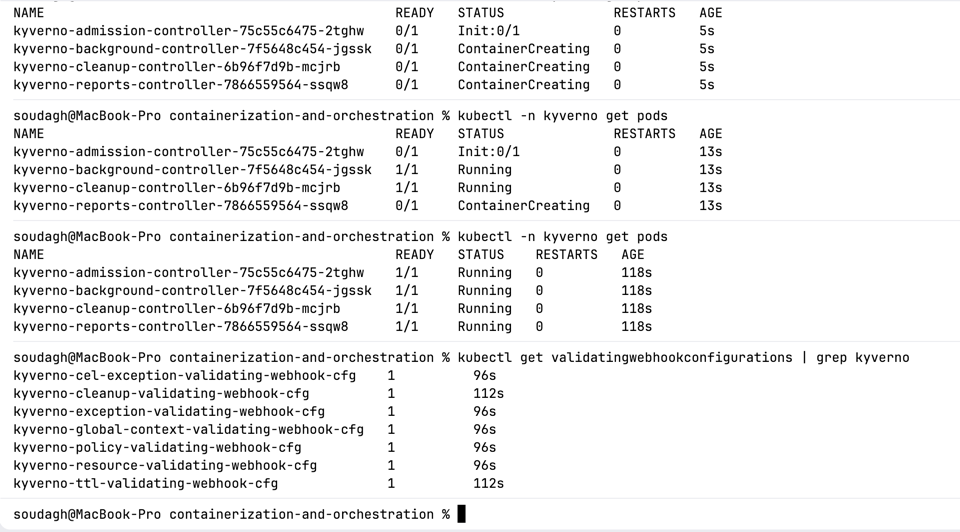

## правила политик

Каждая политика - отдельный файл

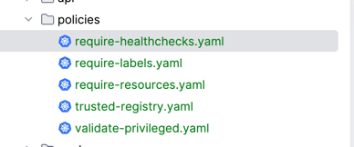

я написала 5 политик:
1. Каждый контейнер должен иметь liveness и readiness пробы

```
apiVersion: kyverno.io/v1
kind: ClusterPolicy
metadata:
  name: require-healthchecks
  annotations:
    policies.kyverno.io/description: >-
      Без хелсчеков не будет ясна доступность контейнера и его работоспособность
spec:
  background: true
  rules:
    - name: require-healthchecks
      match:
        any:
          - resources:
              kinds: [Pod]
      exclude:
        any:
          - resources:
              namespaces:
                - kube-system
                - kyverno
                - cnpg-system
                - monitoring
                - local-path-storage
                - app
                - lab1
      validate:
        failureAction: Enforce
        message: "Каждому контейнеру нужны liveness и readiness пробы"
        pattern:
          spec:
            containers:
              - livenessProbe:
                  periodSeconds: ">0"
                readinessProbe:
                  periodSeconds: ">0"
```

2. Каждый под должен иметь проставленные лейблы

```
apiVersion: kyverno.io/v1
kind: ClusterPolicy
metadata:
  name: require-labels
  annotations:
    policies.kyverno.io/description: >-
      Для грамотной связности контейнеров и сети у каждого пода должны быть проставлены лейблы
spec:
  background: true
  rules:
    - name: require-labels
      match:
        any:
          - resources:
              kinds: [Pod]
      exclude:
        any:
          - resources:
              namespaces:
                - kube-system
                - kyverno
                - cnpg-system
                - monitoring
                - local-path-storage
                - app
                - lab1
      validate:
        failureAction: Enforce
        message: "Каждый под должен иметь лейблы"
        pattern:
          metadata:
            labels:
              app.kubernetes.io/name: "?*"
              app.kubernetes.io/part-of: "?*"

```

3. Каждый контейнер должен иметь ограничения по ресурсам

```
apiVersion: kyverno.io/v1
kind: ClusterPolicy
metadata:
  name: require-resources
  annotations:
    policies.kyverno.io/description: >-
      Без лимитов один под может съесть всю ноду и выселить соседей (OOM, CPU-голод).
spec:
  background: true
  rules:
    - name: containers-have-requests-and-limits
      match:
        any:
          - resources:
              kinds: [Pod]
      exclude:
        any:
          - resources:
              namespaces:
                - kube-system
                - kyverno
                - cnpg-system
                - monitoring
                - local-path-storage
                - app
                - lab1
      validate:
        failureAction: Enforce
        message: "Каждому контейнеру нужны resources.requests и resources.limits по cpu и memory."
        pattern:
          spec:
            containers:
              - resources:
                  requests:
                    cpu: "?*"
                    memory: "?*"
                  limits:
                    cpu: "?*"
                    memory: "?*"
```

4. Каждый образ должен быть стянут с проверенного нашего реестра `registry.shop.local/`

```
apiVersion: kyverno.io/v1
kind: ClusterPolicy
metadata:
  name: trusted-registry
  annotations:
    policies.kyverno.io/description: >-
      Образы в кластере должны стягиваться из проверенных и верифицированных реестров для безопасности и избегания атак
spec:
  background: true
  rules:
    - name: images-pulled-from-verified-registries
      match:
        any:
          - resources:
              kinds: [Pod]
      exclude:
        any:
          - resources:
              namespaces:
                - kube-system
                - kyverno
                - cnpg-system
                - monitoring
                - local-path-storage
                - app
                - lab1
      validate:
        failureAction: Enforce
        message: "Каждый образ должен быть стянут из проверенного реестра registry.shop.local/"
        pattern:
          spec:
            containers:
              - image: "registry.shop.local/*"
            =(initContainers):
              - image: "registry.shop.local/*"

```

5. Каждый контейнер не может быть запущен в привилегированном режиме

```
apiVersion: kyverno.io/v1
kind: ClusterPolicy
metadata:
  name: validate-privileged
  annotations:
    policies.kyverno.io/description: >-
      Запуск контейнера в привилегированном режиме грозит возможностью атак и побега из контейнера
spec:
  background: true
  rules:
    - name: validate-privileged
      match:
        any:
          - resources:
              kinds: [Pod]
      exclude:
        any:
          - resources:
              namespaces:
                - kube-system
                - kyverno
                - cnpg-system
                - monitoring
                - local-path-storage
                - app
                - lab1
      validate:
        failureAction: Enforce
        message: "Каждый контейнер не может быть запущен в привилегированном режиме"
        pattern:
          spec:
            containers:
              - =(securityContext):
                  =(privileged): "false"
            =(initContainers):
              - =(securityContext):
                  =(privileged): "false"
```

Все политики готовы

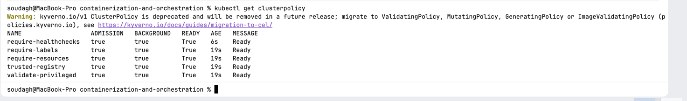

зачем каждая политика:
- лимиты ресурсов - без них один под может съесть всю ноду и выселить соседей (OOM, голод по CPU)
- доверенный реестр - образ из любого публичного реестра может оказаться подменённым или с майнером внутри, а так в кластер попадает только то, что мы сами собрали и положили в свой реестр
- обязательные метки (`app.kubernetes.io/name`, `app.kubernetes.io/part-of`) - по ним во всём кластере понятно, что это за под и частью какой системы он является, на них завязаны фильтры в мониторинге и поиск владельца при инциденте
- запрет privileged - privileged-контейнер по сути имеет полный доступ к ноде, побег из него тривиальный
- обязательные пробы - без них кубер не знает, жив ли контейнер и можно ли пускать на него трафик, и не сможет нормально делать rolling update

из политик исключены системные неймспейсы (`kube-system`, `kyverno`, `local-path-storage`, `cnpg-system`), стек мониторинга (`monitoring`) и старые лабы (`app`, `lab1`). Работающие поды политики не трогают, но при любом пересоздании (рестарт, rollout, выселение) новые поды бы не прошли проверку и, например, мониторинг умер бы в самый нужный момент.

политики проверяют объект до записи в etcd, а не удаляют его потом. Если бы нарушителей чистил контроллер после создания, privileged-контейнер успевал бы поработать, а ReplicaSet бы его тут же пересоздавал по кругу.

вебхук кайверно стоит с `failurePolicy: Fail` - если кайверно лежит, создать под в защищённых неймспейсах нельзя. Это плата доступностью за безопасность (с `Ignore` пока кайверно лежит, проходило бы всё подряд). `kube-system` и сам `kyverno` исключены из вебхука, иначе кластер не смог бы поднять даже сам кайверно.

`ClusterPolicy` в kyverno 1.19 помечены как deprecated, на смену идут `ValidatingPolicy` на CEL, но пока всё работает и для лабы я осталась на них.

## нарушение политик

Теперь для каждой из политик напишем 5 манифестов, каждый из которых будет нарушать ровно одно правило.

Для удобства написания таких манифестов напишу сначала эталон, из которого постепенно будут вычленяться нарушители

Вышел вот такой манифест:

```
apiVersion: apps/v1
kind: Deployment
metadata:
  labels:
    app: check
  name: api
  namespace: default
spec:
  replicas: 1
  selector:
    matchLabels:
      app: check
  strategy: {}
  template:
    metadata:
      labels:
        app: "check"
        app.kubernetes.io/name: api
        app.kubernetes.io/part-of: shop
    spec:
      containers:
        - image: registry.shop.local/api:0.1.0
          imagePullPolicy: IfNotPresent
          name: check1
          ports:
            - containerPort: 8080
          resources:
            limits:
              memory: 200Mi
              cpu: 500m
            requests:
              cpu: 100m
              memory: 64Mi
          readinessProbe:
            httpGet:
              path: /health
              port: 8080
          livenessProbe:
            httpGet:
              path: /health
              port: 8080
status: {}
```

`kubectl apply` для этого манифеста проходит успешно

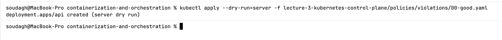

Теперь 5 манифестов, которые нарушают соответствующие правила:

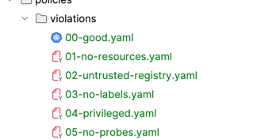

И пытаемся прогнать `kubectl apply` и видим ошибки

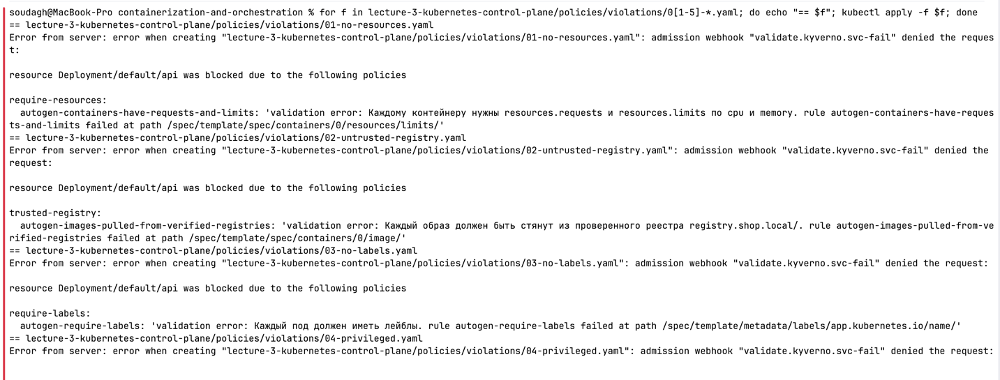

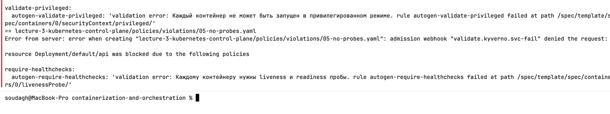

# Часть 2: Helm-чарт shop

Сформируем чарт, который ставит 3 реплики api и 2 реплики worker. Этот чарт должен проходить все 5 политик

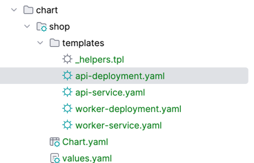

Пример `api-deployment.yaml`:

```
apiVersion: apps/v1
kind: Deployment
metadata:
  name: {{ .Release.Name }}-api
  labels:
    {{- include "shop.labels" (dict "ctx" . "component" "api") | nindent 4 }}
spec:
  replicas: {{ .Values.api.replicas }}
  selector:
    matchLabels:
      {{- include "shop.selectorLabels" (dict "ctx" . "component" "api") | nindent 6 }}
  template:
    metadata:
      labels:
        {{- include "shop.labels" (dict "ctx" . "component" "api") | nindent 8 }}
    spec:
      containers:
        - name: api
          image: "{{ .Values.api.image.repository }}:{{ .Values.api.image.tag | default .Chart.AppVersion }}"
          imagePullPolicy: IfNotPresent
          ports:
            - name: http
              containerPort: 8080
          env:
            - name: HEALTH_FAIL
              value: {{ .Values.api.healthFail | quote }}
            - name: DATABASE_URL
              valueFrom:
                secretKeyRef:
                  name: {{ .Values.database.secretName }}
                  key: uri
                  optional: true
          resources:
            {{- toYaml .Values.api.resources | nindent 12 }}
          livenessProbe:
            {{- toYaml .Values.api.livenessProbe | nindent 12 }}
          readinessProbe:
            {{- toYaml .Values.api.readinessProbe | nindent 12 }}

```

Теперь пытаемся запустить:

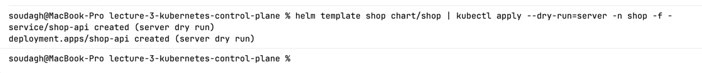

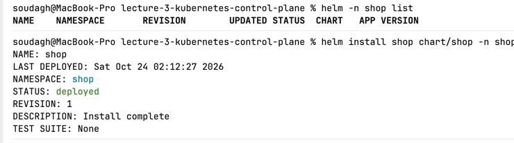

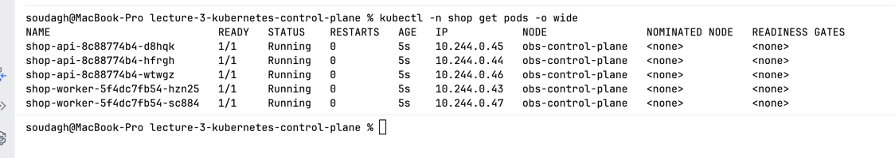

чарт проходит все пять политик.

## reconciliation

удаляю api под `shop-api-8c88774b4-d8hqk`

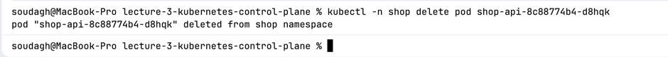

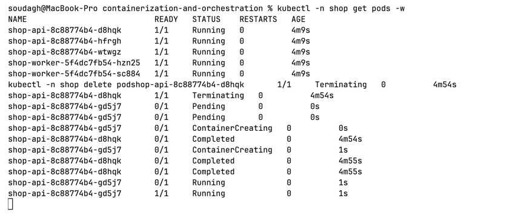

старый под api уходит в статус `Terminating`, а новый появляется ещё до того, как старый исчезнет.

Попробуем эксперимента ради поменять количество реплик на 5 и обновить кластер:

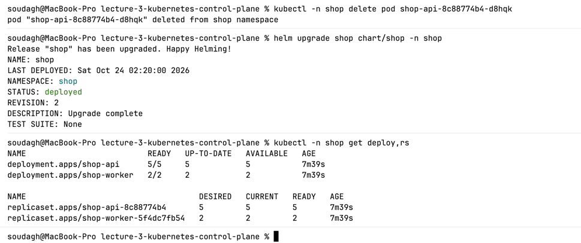

стало пять реплик:

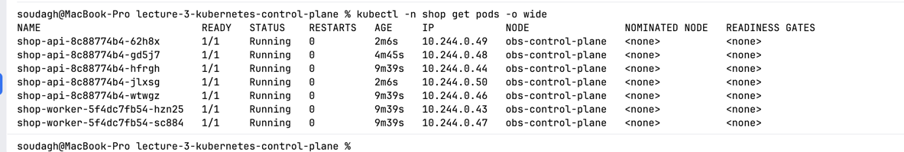

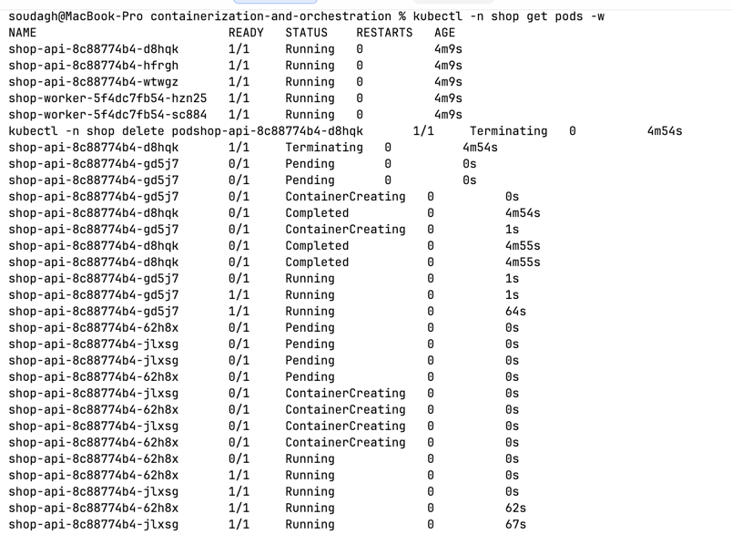

теперь вернём количество реплик снова на значение 3:

реплик снова 3, видим, как лишние реплики переходят в статус "Terminating" и выходят из кластера

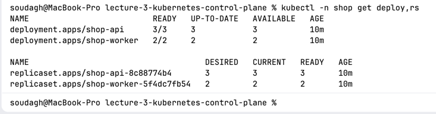

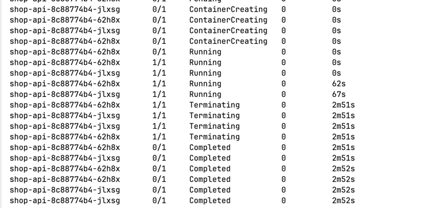

удалённый под вернул ReplicaSet-контроллер, а не Deployment: он сравнивает свой `replicas` с количеством живых подов и досоздаёт недостающие. Deployment управляет только ReplicaSet-ами.

при смене `replicas` новый ReplicaSet не создаётся - количество реплик не входит в шаблон пода, хэш шаблона (`pod-template-hash`) тот же, так что меняется только `replicas` у старого RS. А вот смена образа или лимитов меняет шаблон, значит новый хэш и новый RS.

## rolling-update

дадим нагрузку на под и попытаемся обновить тег образа:

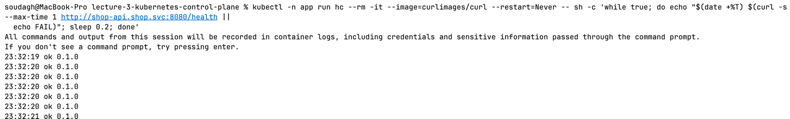

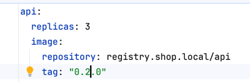

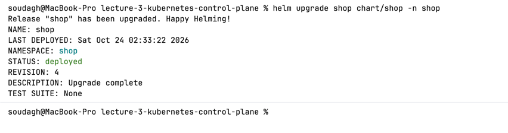

Смена образов произошла с одним фейлом:

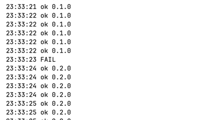

И так происходила ротация контейнеров:

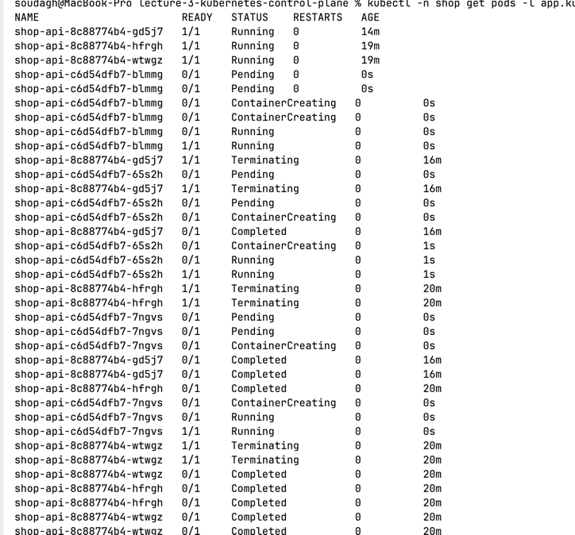

Фейла быть не должно, поэтому пытаемся разобраться, почему это произошло. Проблема заключается в том, что трафик до сих пор шёл на уходящий под, несмотря на то, что процесс закрыл порт. Для этого нужен хук на prestop

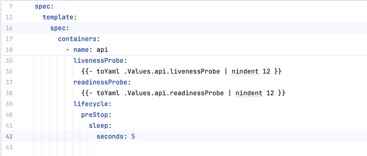

Теперь меняю тег обратно на "0.1.0" и смотрю на то, чтобы фейлов не было

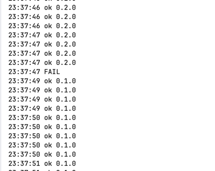

Фейл снова есть.

А проблема заключалась в том, что я обновила чарт одной командой - то есть поды ещё не имели preStop, а я уже поменяла тег образа. Ну теперь, если я поменяю тег снова на 0.2.0, то фейла не будет. Так ведь? ведь так?


да, это так.

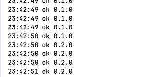

почему поды обновлялись по одному: при 3 репликах и стратегии по умолчанию `maxSurge` = 25% от 3 с округлением вверх = 1, а `maxUnavailable` = 25% с округлением вниз = 0. То есть сначала создаётся один новый под, ждём его readiness и только потом удаляем один старый.

а фейл был из-за гонки при остановке пода: kubelet шлёт SIGTERM и параллельно под убирается из EndpointSlice, и пока kube-proxy не обновил правила, трафик ещё идёт на под, который уже закрыл порт. `preStop` со `sleep: 5` даёт сети время забыть под до остановки процесса. `sleep` через `exec` в distroless бы не сработал, там нет такого бинарника, поэтому встроенный `lifecycle.preStop.sleep`. И хук берётся из спеки останавливаемого пода, поэтому его надо было выкатывать отдельно до смены версии.

## сломанный rollout и rollback

проставим healthFail = true

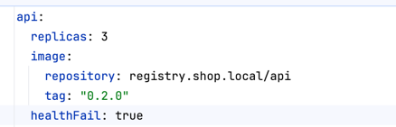

Обновляем чарт:

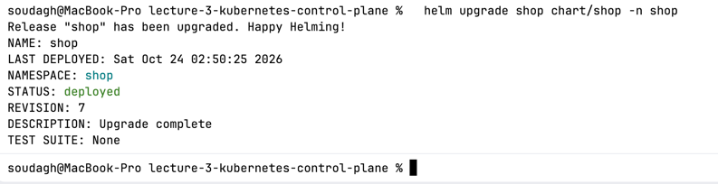

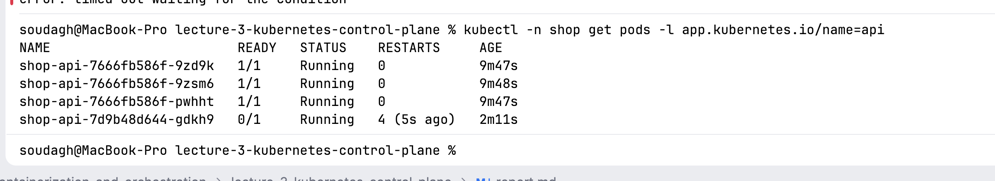

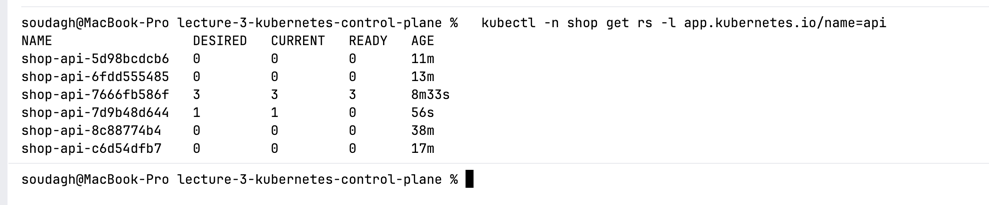

видно, что один из новых подов не поднялся и рестартится. При этом в терминале с нагрузкой нет ни одного фейла.

Теперь производим откат:

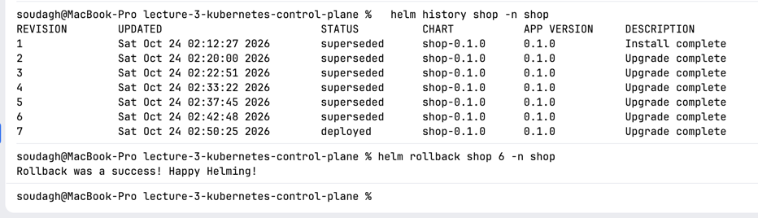

После этого смотрим состояние подов - все поды подняты и никто не рестартится.

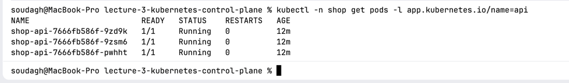

старые поды при этом вообще не перезапускались: при `maxUnavailable: 0` деплоймент не имеет права удалить старый под, пока новый не станет ready, а он не станет никогда, поэтому роллаут просто завис и трафик продолжили обслуживать старые поды. При откате новый ReplicaSet тоже не создавался - шаблон старой ревизии дал тот же хэш, деплоймент вернул старый RS основным и удалил сломанный под.

при этом helm записал сломанную ревизию как `Upgrade complete` - без флагов он проверяет только то, что апи-сервер принял объекты, а не то, что поды поднялись. Чтобы helm сам заметил проблему, нужен `--wait --timeout`, а с `--atomic` (в helm 4 `--rollback-on-failure`) он ещё и сам откатится.

# Часть 3: Postgres через оператор

Оператор необходим для полноценной эксплуатации базы - необходимо знание о том, как инициализировать кластер, кто primary, кто реплика, как сделать failover, бэкап, восстановление, как безопасно обновить мажорную версию.

Оператор по факту это контроллер со знаниями предметной области плюс CRD.

## установка оператора

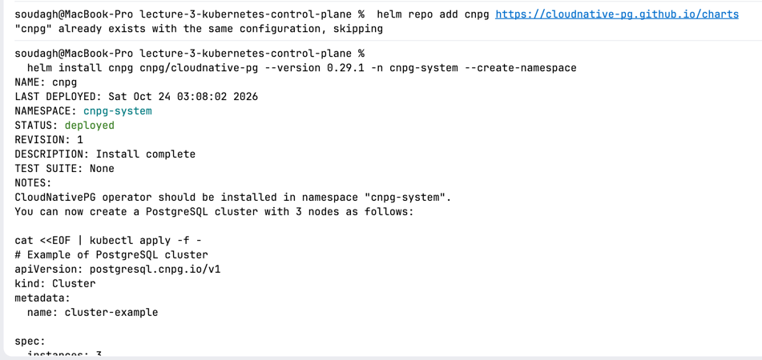

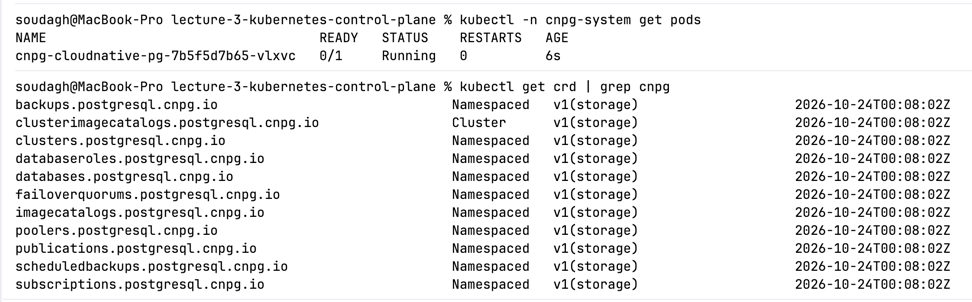

## объект Cluster в чарте

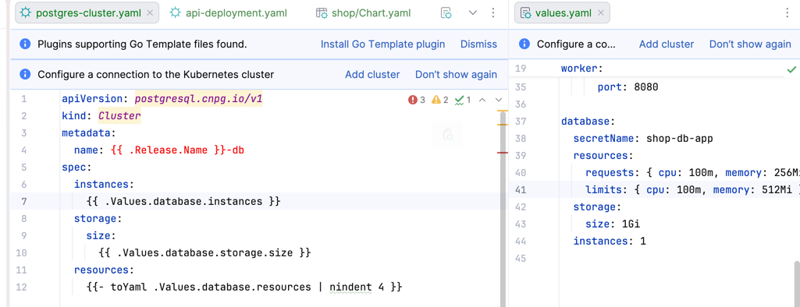

как видим, подов `shop-db`, связанных с бд, не наблюдается, а PVC находится в состоянии Pending. Primary-инстанс до сих пор настраивается, хотя прошло уже около 8 минут. Если глянуть логи, то заметим, что ошибки связанные с проблемой прохождений политик.

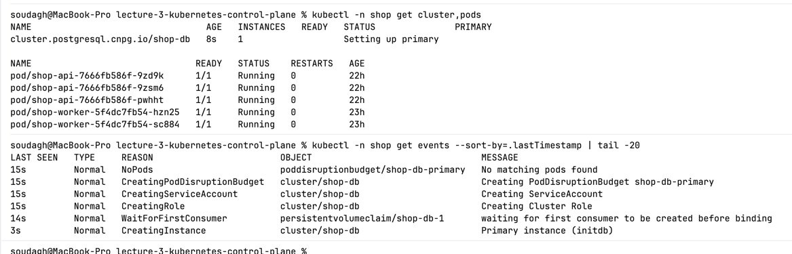

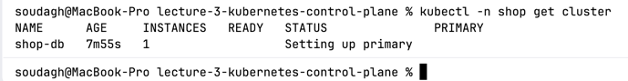

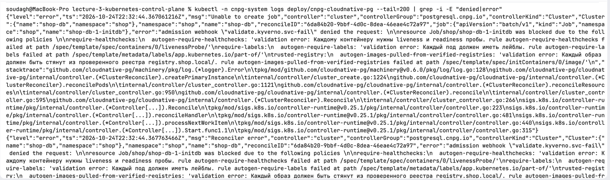

Так как одна из политик у нас связана с тем, что образы должны стягиваться только с нашего registry, то нужно расширить её, чтобы мы могли подгружать образ оператора. Тогда условие политики будет выглядеть так:

```bash
- image: "registry.shop.local/* | ghcr.io/cloudnative-pg/*"
```

Также нужно пересмотреть политику с хелсчеками - здесь она, наоборот, написана слишком широко. Под неё попадают джобы, которые что-либо отрабатывают и завершаются + трафика на них не идёт. Следовательно политику лучше переписать под долгоживущие поды.

И ещё одна политика связана с лейблами - Кластер не перенимал лейблы, что и было исправлено в его спеке.

После фиксов всё поднялось

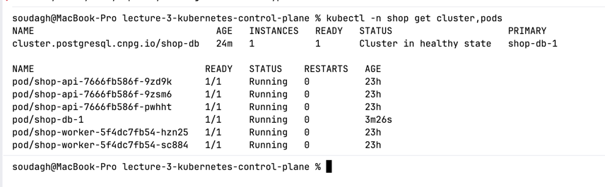

проверка того, что приложение видит бд:

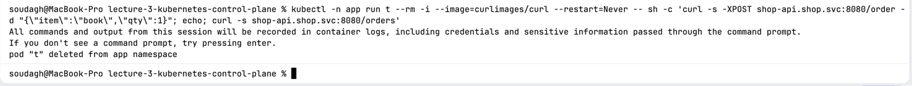

Приложение бд не видит, так как оно крутилось ещё до того момента, как мы задали креды для бд. Поэтому пытаемся перезапустить поды, чтобы они подхватили креды:

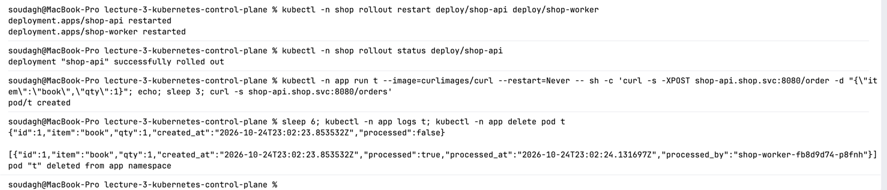

Приложение видит бд и успешно обрабатывает ивенты

## reconciliation оператора, spec и status

Владельцем пода бд является Cluster, когда же владельцем пода приложения - ReplicaSet.

попробуем убрать под и проверить, что у нас ничего не пропало и всё останется на месте

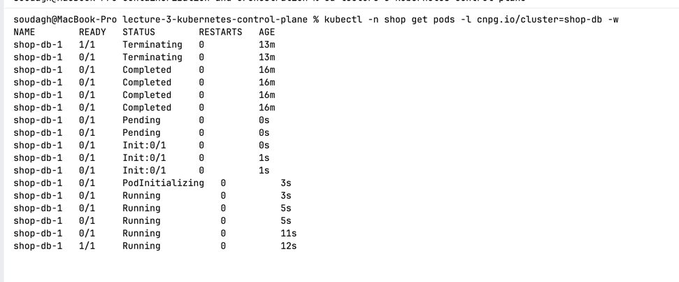

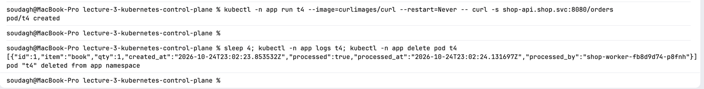

можно заметить, что под вернулся с тем же именем, с тем же PVC. Также можем заметить и механику smart shutdown с таймаутом в 180 секунд

spec:

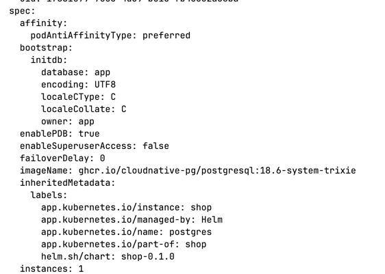

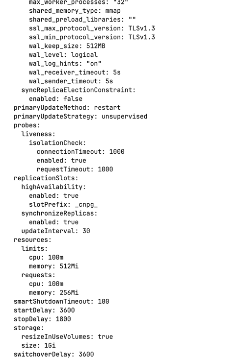

status:

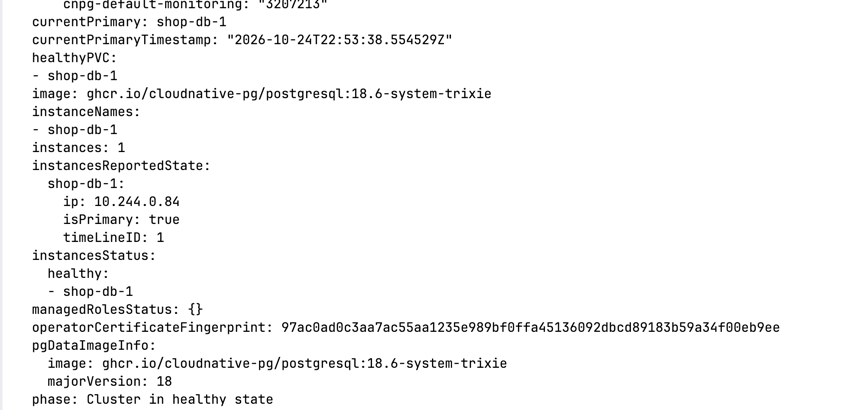

про smart shutdown: у постгреса три режима остановки - smart (новые подключения не принимаем, ждём пока клиенты сами отключатся), fast (обрываем сессии, откатываем транзакции, делаем checkpoint) и immediate (без checkpoint, потом crash recovery). Оператор при удалении пода сначала делает smart до `smartShutdownTimeout` (180с), потом fast, а pod-у ставит `terminationGracePeriodSeconds` = `stopDelay` (1800с). Наши api и worker через пул держат соединения постоянно, поэтому smart честно прождал все 180 секунд. Базе важнее корректно дописать данные, чем быстро остановиться, и оператор это знает.

почему для трёх политик решения разные: метки - требование разумное, и оператор умеет его выполнять через `inheritedMetadata`, так что чиним приложение. Реестр - доверяем конкретному вендору `ghcr.io/cloudnative-pg/*`, а не всему ghcr. Пробы - политика была шире, чем её смысл, у джобов проб быть не должно. И просто исключить `shop` из политик нельзя - тогда пропали бы проверки и для наших же api и worker.

## чем оператор отличается от controller-manager

общее у них - механизм: оба контроллеры с циклом reconciliation, подписываются через watch на свои объекты, сравнивают spec с реальностью, действуют через тот же апи и пишут результат в status, проставляют ownerReferences.

отличия:
- controller-manager работает со встроенными типами (Deployment, ReplicaSet, Job...), они вкомпилированы в апи-сервер. Оператор приносит свои типы через CRD (`Cluster`, `Backup`...)
- controller-manager знает только общие вещи вроде "держать N копий пода", а что внутри контейнера, ему всё равно. В оператор зашиты знания о предметной области: initdb, кто primary, реплики и failover, бэкапы, как правильно останавливать постгрес
- controller-manager - часть control plane, а оператор - обычный деплоймент в кластере, который ставится хелмом

ещё один аргумент за оператор: постгрес нельзя просто положить в Deployment с PVC `ReadWriteOnce`. При rolling update `maxSurge` = 1, и на какое-то время будет два пода на одном томе. На одной ноде RWO не мешает (он про ноду, а не про под), и два постгреса начнут писать в одни и те же файлы. На разных нодах второй под не примонтирует том и роллаут зависнет навсегда.

# Часть 4: Отказ control plane

попытаемся отвязать мозг кубернетеса от его рук. Гипотеза такова, что если остановить etcd, то ничего нового сделать будет нельзя, но работающее продолжит работать.

ClusterIP `10.96.41.81`

```bash
docker exec obs-control-plane curl -s http://10.96.41.81:8080/health
```

Останавливаем etcd:

```bash
docker exec obs-control-plane mv /etc/kubernetes/manifests/etcd.yaml /root/etcd.yaml
```

попробую изменить версию shop:

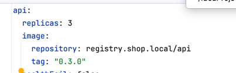

при попытке обращения к kubectl запросы висят, а потом падают по таймауту

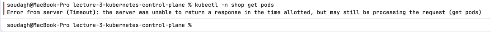

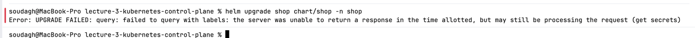

при этом сам сервис жив:

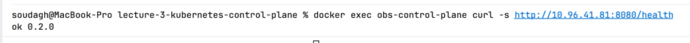

Теперь посмотрим живо ли всё по содержанию и взаимодействию:


Видим, что всё продолжает работать как надо и записи успешно пишутся и обрабатываются.

теперь возвращаем etcd:

```bash
docker exec obs-control-plane mv /root/etcd.yaml /etc/kubernetes/manifests/etcd.yaml
```

и команды kubectl снова работают


почему всё выжило: kubelet держит поды, которые ему уже назначены, и сам перезапускает упавшие контейнеры по `restartPolicy` - control plane для этого не нужен. Сервис по ClusterIP работает, потому что kube-proxy заранее записал правила iptables/nftables в ядро ноды по EndpointSlice-ам, и они продолжают работать сами по себе. Postgres и worker вообще ни от апи-сервера ни от etcd не зависят.

что бы не выжило: всё, что требует решения на уровне кластера. Если умрёт нода, никто не создаст новые поды (нужен ReplicaSet-контроллер, scheduler и запись в etcd). Если у пода сменится IP, EndpointSlice не обновится и kube-proxy продолжит слать трафик на старый адрес. Ну и любые изменения - kubectl, helm - не проходят, запросы висят, потому что апи-сервер ждёт etcd, а потом сам начинает падать на liveness.

# Часть 5: мониторинг

теперь нужно настроить мониторинг так, чтобы чарт приложения сам подключал к мониторингу свои сервисы и приносил свои алерты.

## ServiceMonitor


в пром всё подтянулось


## Алерты

+ api перестал видеть базу:

shop_db_up{namespace="shop",container="api"} == 0

for: 1m

severity: critical

Приложение не видит базу. Невозможно чтение и запись в базу, приложение не может корректно работать

+ запросы к апи превышают 3 секунды

histogram_quantile(0.95, sum by(le) (rate(http_request_duration_seconds_bucket{namespace="shop", route != "/health"}[5m]))) > 3

for: 3m

severity: warning

Запросы по методам api превышают три секунды - пользователь видит задержки в отображении приложения.

+ Количество ответов, содержащих 5XX ошибку, превышает 30 процентов от всех запросов

sum(rate(http_requests_total{namespace="shop", route != "/health", code =~ "5.."}[5m]))

/

sum(rate(http_requests_total{namespace="shop",route != "/health"}[5m])) > 0.3

for: 5m

severity: critical

30 процентов запросов к api завершаются 500 ошибкой - приложение в какой-то части работает некорректно.

Получившийся файл `prometheusrule.yaml`:

```
apiVersion: monitoring.coreos.com/v1
kind: PrometheusRule
metadata:
  name: {{ .Release.Name }}
  labels:
    release: kps
    app.kubernetes.io/part-of: shop
spec:
  groups:
    - name: shop.rules
      rules:
        - alert: ApiServiceHasNoConnectionToDBError
          expr: shop_db_up{namespace="shop",container="api"} == 0
          for: 1m
          labels:
            severity: critical
          annotations:
            summary: "Api сервис перестал видеть БД"
            description: Приложение не видит базу. Невозможно чтение и запись в базу, приложение не может корректно работать
        - alert: ApiLatencyDegraded
          expr: histogram_quantile(0.95, sum by(le) (rate(http_request_duration_seconds_bucket{namespace="shop", route != "/health"}[5m]))) > 3
          for: 3m
          labels:
            severity: warning
          annotations:
            summary: "Запросы к апи превышают 3 секунды"
            description: Запросы по методам api превышают три секунды - пользователь видит задержки в отображении приложения.
        - alert: Api5XXErrorsHigh
          expr: sum(rate(http_requests_total{namespace="shop", route != "/health", code =~ "5.."}[5m])) / sum(rate(http_requests_total{namespace="shop",route != "/health"}[5m])) > 0.3
          for: 5m
          labels:
            severity: critical
          annotations:
            summary: "Больше 30 процентов запросов к api завершаются 5xx ошибками"
            description: Больше 30 процентов запросов к api завершаются 500 ошибкой - приложение в какой-то части работает некорректно.
```

рулы отображаются в проме:


теперь спровоцируем их, чтобы увидеть, что алерты будут гореть: дадим нагрузку на `/orders` и остановим базу


через минуту после остановки базы загорелся соответствующий алерт + алерт на пятисотки перешёл в состояние ожидания.


через пять минут уже и алерт с пятисотками загорелся


после восстановления базы алерты успешно резолвнулись


как это всё подтянулось без правки конфига прометеуса: ServiceMonitor и PrometheusRule - это CRD от prometheus-operator. Оператор видит новые объекты, проверяет, что у них есть метка `release: kps` (это `serviceMonitorSelector`/`ruleSelector` у объекта `Prometheus`), генерирует из них конфиг и правила, а sidecar config-reloader перезагружает прометеус. Без метки оператор бы молча проигнорировал объект.

из-за одной причины (упала база) загорелись два алерта. Чтобы не будить дважды, в alertmanager можно добавить `inhibit_rules`: пока горит алерт про базу, глушить алерт про 5xx в том же неймспейсе. Глушить надо именно 5xx, потому что падение базы всегда даёт 5xx, а 5xx бывают и без падения базы.


