# Лабораторная работа 4
нужно пожертвовать чем-то старым, чтобы обрести что-то новое


# Часть 1: механизм разнесения
у нас есть два способа, как сказать планировщику не класть реплики месте - это `podAntiAffiity` - правило не ставить вместе с подами определённой метки, и `topologySpreadConstraints` - правило для расстановки реплик равномерно по доменам топологии

к нашему api в values дописываю правила для topologySpread и antiAffinity, а также настройки для них. Для anti-affinity у выбираю preferred, так как у нас 3 реплики и две ноды - если брать required, то третья реплика никогда не запустится, а для topologySpread ставлю maxSkew 1,  тогда на двух нодах будет схема 2 + 1, и whenUnsatisfiable: DoNotSchedule

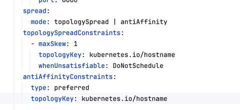

# Часть 2: площадка с ужатыми ресурсами и batch в чарте
Хоть нода и видит 8 CPU и 7.6 ГБ, но воркер будет пользоваться только 2 cpu и около 1.65 ГБ - проставлен system-reserved. Также был проставлен eviction-hard: memory.available<5gi на воркер - kubelet будет выселять поды, когда на ноде будет меньше 5 ГБ свободной памяти

Спека кластера: 

```
kind: Cluster
apiVersion: kind.x-k8s.io/v1alpha4
name: lab4
nodes:
  - role: control-plane
    image: kindest/node:v1.37.0
    kubeadmConfigPatches:
      - |
        kind: InitConfiguration
        nodeRegistration:
          taints: []           
          kubeletExtraArgs:
            - name: system-reserved
              value: "cpu=4,memory=2Gi" 
  - role: worker
    image: kindest/node:v1.37.0
    kubeadmConfigPatches:
      - |
        kind: JoinConfiguration
        nodeRegistration:
          kubeletExtraArgs:
            - name: system-reserved
              value: "cpu=6,memory=1Gi
            - name: eviction-hard
              value: "memory.available<5Gi"

```

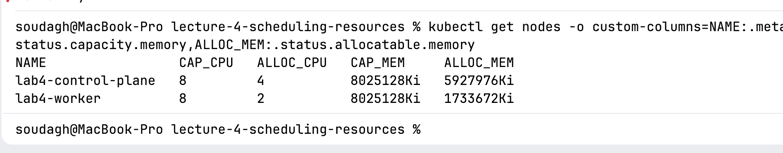

и для батча:

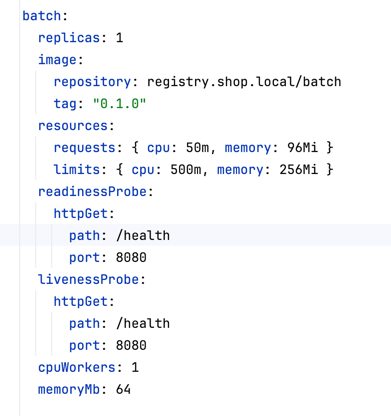

CPU-лимиты обычно не ставят latency-чувствительным сервисам из-за троттлинга, но здесь мы ставим их api ради Guaranteed QoS и платим за это риском троттлинга

```
apiVersion: apps/v1
kind: Deployment
metadata:
  name: {{ .Release.Name }}-batch
  labels:
    {{- include "shop.labels" (dict "ctx" . "component" "batch") | nindent 4 }}
spec:
  replicas: {{ .Values.batch.replicas }}
  selector:
    matchLabels:
      {{- include "shop.selectorLabels" (dict "ctx" . "component" "batch") | nindent 6 }}
  template:
    metadata:
      labels:
        {{- include "shop.labels" (dict "ctx" . "component" "batch") | nindent 8 }}
    spec:
      containers:
        - name: batch
          image: "{{ .Values.batch.image.repository }}:{{ .Values.batch.image.tag | default .Chart.AppVersion }}"
          imagePullPolicy: IfNotPresent
          ports:
            - name: http
              containerPort: 8080
          env:
            - name: CPU_WORKERS
              value: {{ .Values.batch.cpuWorkers | quote }}
            - name: MEMORY_MB
              value: {{ .Values.batch.memoryMb | quote }}
          resources:
            {{- toYaml .Values.batch.resources | nindent 12 }}
          livenessProbe:
            {{- toYaml .Values.batch.livenessProbe | nindent 12 }}
          readinessProbe:
            {{- toYaml .Values.batch.readinessProbe | nindent 12 }}

```

и получился Burstable класс для нашего пода

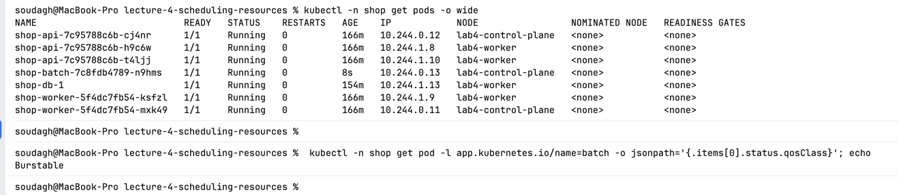

# Часть 3 - Настройка лимитов с помощью KRR
Сейчас все значения для requests/limits для подов взяты из головы, а по-хорошему нужно основываться на фактическом потреблении. Для этого есть инструмент krr (Kubernetes Resource Recommender) и считает рекомендации

Сейчас следующие лимиты:
+ api:
```
    requests: { cpu: 50m, memory: 32Mi }
    limits: { cpu: 200m, memory: 128Mi }
```
+ worker:
```
    requests: { cpu: 50m, memory: 32Mi }
    limits: { cpu: 200m, memory: 128Mi }
```
+ database:
```
    requests: { cpu: 100m, memory: 256Mi }
    limits: { cpu: 100m, memory: 512Mi }
```
+ batch:
```
    requests: { cpu: 50m, memory: 96Mi }
    limits: { cpu: 500m, memory: 256Mi }
```
пока я жду, чтобы пособирались данные для krr, можно посидеть подумать, что krr увеличит, а что уменьшит
для api, я думаю, он запросит больше процессорного времении и памяти, для постгреса, возможно, поставит значения чуть меньше, а для воркера увеличит requests, но уменьшит limits

спустя 30 минут появился отчёт:
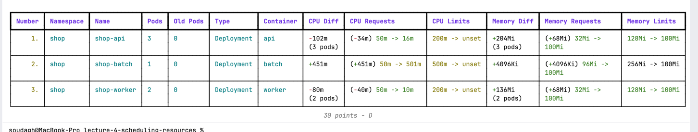
как можно заметить, постгри тут нет - krr перебирает контроллеры и смотрит на их поды, а под бд создан напрямую оператором - его владелец Cluster, а для krr такого типа не сущетсвует. Поэтому посчитаю для постгри руками по той же формуле, что у krr

также krr имеет пол для рекомендаций - 100 Mi и 10m. Поэтому посоветовать значения ниже он банально не мог
На основе фактов выше сопоставляем всё с прогнозами:
+ api - krr предложил меньше cpu (16m против 500) и формально больше памяти - 100Mi против 32Mi. Но тут помним про пол
+ worker - для requests - krr предложил увеличение по памяти, опять 100Mi, то есть нижнее значение по рекомендации, по CPU тоже предложил нижнее значение  - 10m. Для limits - CPU-лимит был убран в krr вовсе.
+ postgres считаем по формуле самостоятельно:
  + CPU request (95 перцентиль за час, в ядрах)
  `quantile_over_time(0.95, rate(container_cpu_usage_seconds_total{namespace="shop",pod="shop-db-1",container="postgres"}[5m])[1h:1m])` - 0.0332652887641247 - около 35m
    + максимум в памяти в МиБ
`max_over_time(container_memory_working_set_bytes{namespace="shop",pod="shop-db-1",container="postgres"}[1h]) / 2^20` - 163.2109375 * 1,15 ~ около 190Mi
 Прогноз для на меньше сбылся, но не "чуть меньше", а заметно меньше - 35m вместо 100m, а память около 190Mi вместо requests 256 Mi и limits 512 Mi.

На основе рекомендаций я решила проставить следующие значения:
+ api - значения для cpu я выбрала в 10 раз больше для того, чтобы мы и не столкнулись с проблемой ограничения лимита cpu, и чтобы не занимали лишний раз ресурсы кластера
```
    requests: { cpu: 200m, memory: 100Mi }
    limits: { cpu: 200m, memory: 100Mi }
```
+ worker
```
    requests: { cpu: 10m, memory: 100Mi }
    limits: { cpu: 100m, memory: 100Mi }
```
+ database - решение по увеличению cpu такое же, как и в случае с api
```
    requests: { cpu: 350m, memory: 256Mi }
    limits: { cpu: 350m, memory: 256Mi }
```

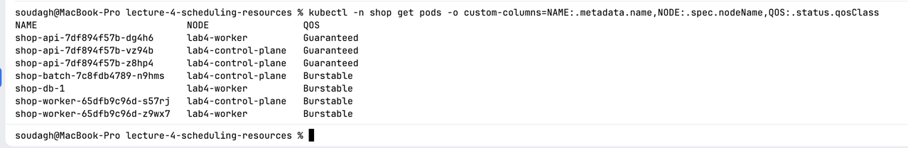

три реплики api теперь имеют QOS Guaranteed.

# Часть 4: разделение реплик api по нодам
сейчас реплики 2+1 у api стоят по случайности, а не по правилу - при следующей раскатке они спокойно могут лечь и в структуру 3 + 0.

дополненный api-deployment под режимы:

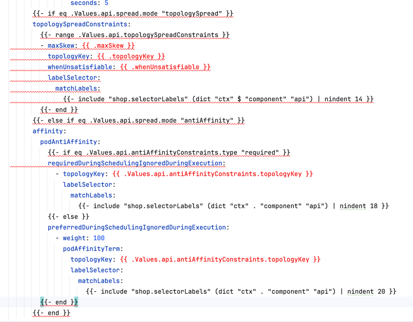

после рестарта 2 реплики оказались на worker ноде, а 1 реплика - на control plane. На всякий случай проверим, что нам не просто повезло - ставим 4 реплики
`kubectl -n shop scale deploy shop-api --replicas=4 && sleep 15 && kubectl -n shop get pods -l app.kubernetes.io/name=api -o wide`

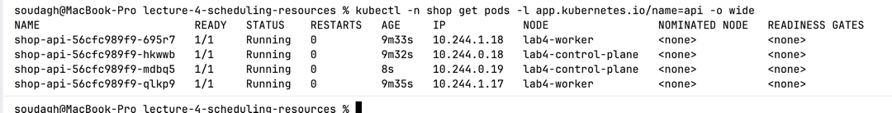

2 реплики на worker ноде, и 2 реплики на control plane

и теперь возвращаем три реплики:
`kubectl -n shop scale deploy shop-api --replicas=3`

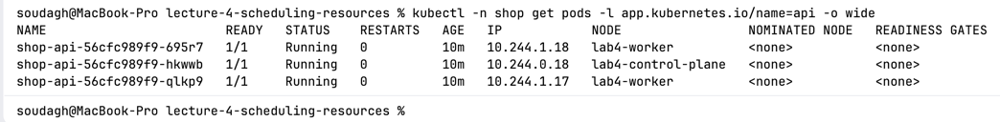

получилась конфигурация 2+1, как мы и хотели

# Часть 5: приоритеты и гарантии

теперь нужно завести PriorityClass и PodDisruptionBudget, а также назначить приоритет уже существующим нашим контейнерам. Для api и postgres мы ставим высший приоритет, когда для batch низший - в случае необходимости, он будет выселен первй

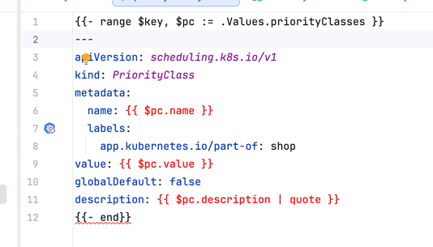
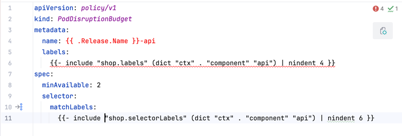


для постгри pdb уже был создан - свой поверх делать не нужно, так как два pdb на одни и те же поды Eviction API объединять не умеет.

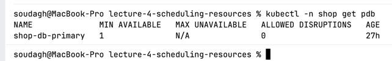

теперь если посмотреть на приоритеты, то можно увидеть те, которые мы определили:

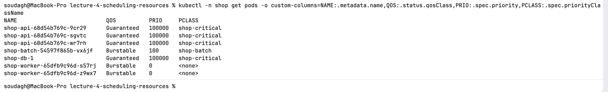

# Часть 6: нехватка и preemption
проверим, что поды вытесняются на основе того, что планировщик отбирает поды по превышенным параметрам requests

Так как планировщик смотрит только на requests, то батчу для эксперимента не надо жечь cpu

Обновлённые значения для batch:

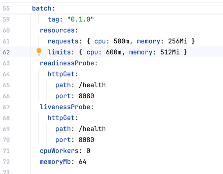

Даю нагрузку, и постепенно поднимаю количество реплик до того момента, пока часть подов не зависнет в статуса Pending

Состояние до эксперимента (1 реплика batch):

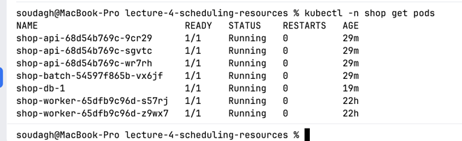

3 реплики batch:

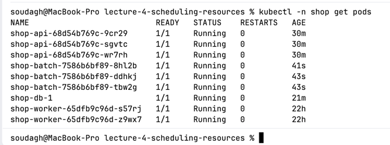

6 реплик batch:

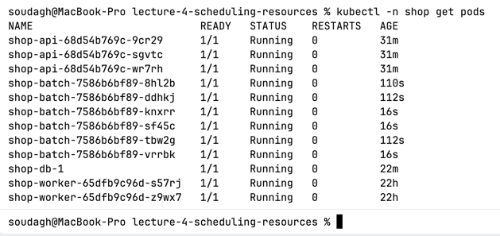

10 реплик batch: 
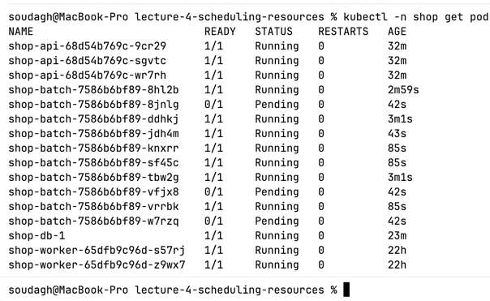

3 реплики batch повисли в состоянии ожидания

если посмотреть ошибки, то видим лог `  preemption: 0/2 nodes are available: 2 Insufficient cpu.`. Планировщик не нашёл, кого выселить, следовательно, не знает, как освободить 500m для batch. Поэтому под остаётся в Pending состоянии

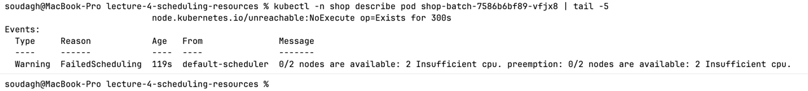


если смотрим по потреблению, то на lab4-worker занято 98 процентов cpu по requests - нода по факту простаивает, так как batch с cpuWorkers: 0

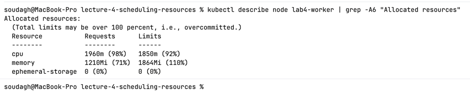

теперь preemption: сделаю апдейт для пода апи, чтобы в момент роллинг апдейта нужно было создать более приоритетную ноду.


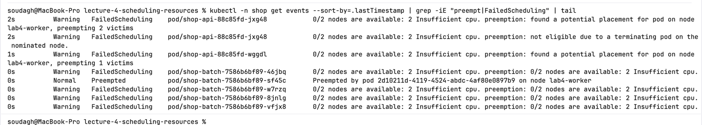

видим preempted события - планировщик дважды вытеснил по одному batch, по одноу на каждой ноде.

# Часть 7: давление по памяти и порядок жертв

Проводим эксперимент с тем, что, когда на ноде кончается память, то kubelet сам будет выселять поды. Первым должен уйти batch, а api и pg остаются.

для этого я проставляю большие лимиты по памяти для батча, а также делаю так, чтобы он набирал эти лимиты за две минуты работы

два батча на воркер ноде + воркеры с приоритетом 1000, то есть батчи ниже воркеров по приоритету

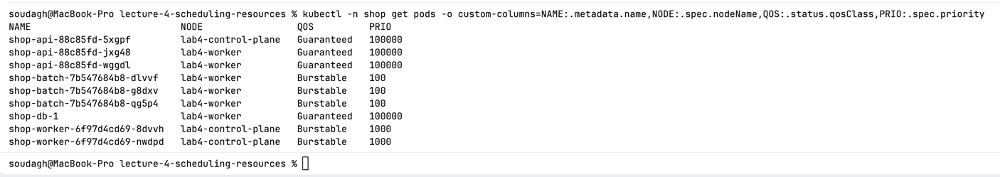

теперь запускаем разгон памяти и наблюдаем:
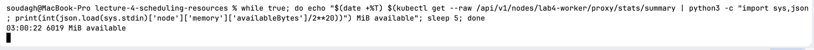

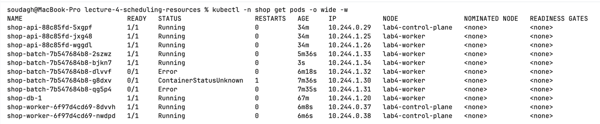

видим ошибки, анализируем их:

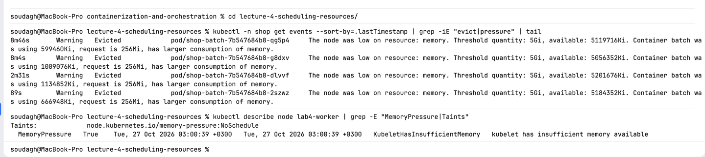

Видим, что не хватает памяти, из-за чего и произошло вытеснение батч-подов - видим события ноды `EvictionThresholdMet` и `NodeHasInsufficientMemory`. И eviction крутится по кругу, так как у нас держится 2 реплики батча и реплика сет пытается создать новую взамен выселенной, и, так как у нас специально выбрана настройка на nodeSelector на lab4-worker, то из-за набора памяти вытеснение повторяется.

теперь сравним с OOMKilled - поставим батчу memoryMb: 1500 при лимите 1280Mi и с одной репликой - тогда под упрётся в свой лимит по памяти раньше, чем нода почувствует её нехватку.

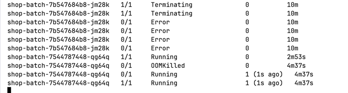

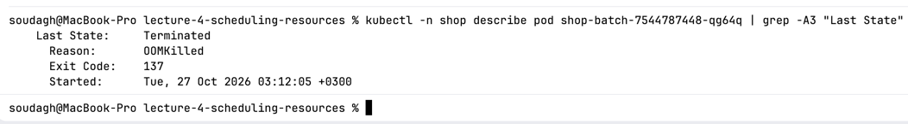

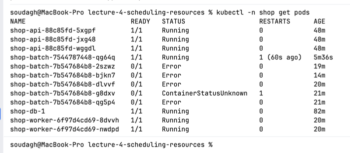

видим, что поды уходят в OOMKilled и они рестартятся

если сравнивать между eviction и OOMKilled:

| | eviction | OOMKilled |
|---|---|---|
| кто убивает | kubelet | ядро |
| что сработало | память ноды опустилась ниже 5Gi | контейнер упёрся в свой memory.max = 1280Mi |
| что с подом | под Failed/Evicted, ReplicaSet создаёт новый | тот же под, kubelet перезапускает контейнер, RESTARTS растёт, дальше CrashLoopBackOff с нарастающей паузой |
| где причина | pod.status.reason/message | containerStatuses[].lastState.terminated.reason |

# Часть 8: SLA под нагрузкой
при нагрузке 200 рпс на /order и во время перегрузки батча на lab4-worker
baseline: p50 1.8 ms, p95 42 ms, p99 97 ms

sla: Duration - p50 - 10 ms, p95 - 100 ms, p99 - 250 ms за 5 минут

sla: errors - не больше 1 процента ответов /order с кодом не 2xx за 5 минут

теперь даём нагрузку:

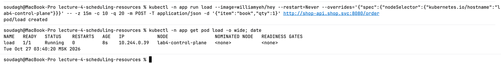


через 2-3 минуты ставлю батч в режиме нагрузки:

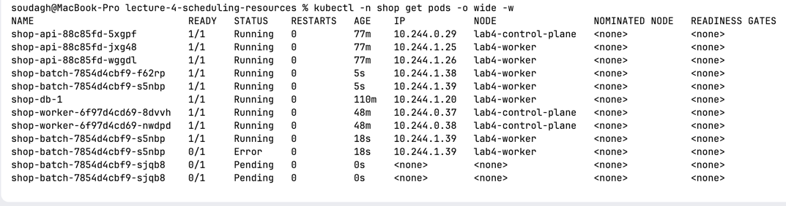

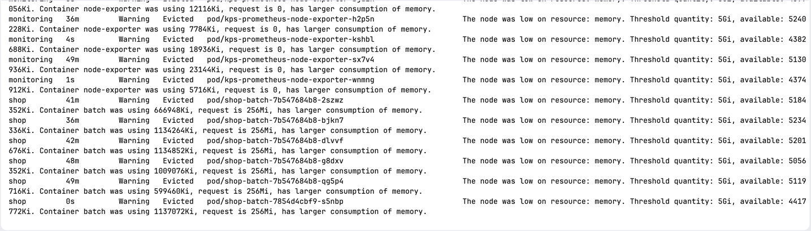

спустя 30 минут после нагрузки:

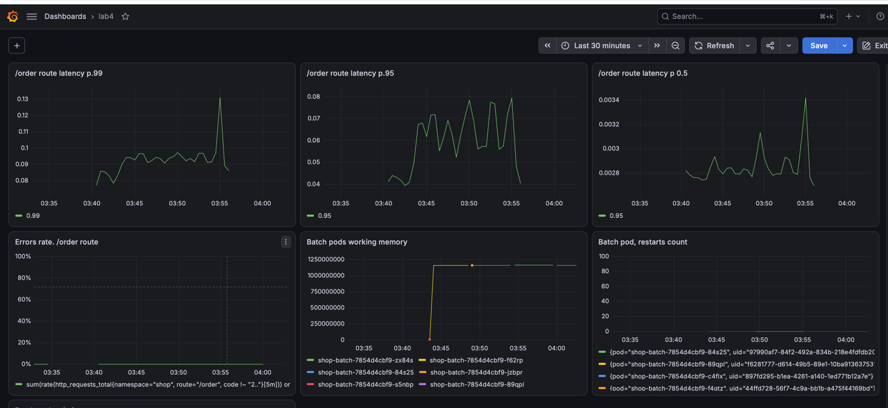

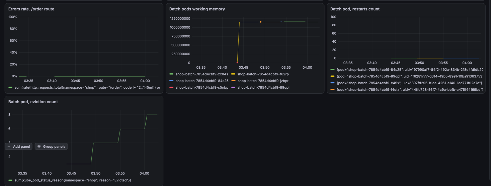

заданный SLA был выдержан - по графикам прома:
+ p50: ~2.8ms
+ p95: пики до ~78ms
+ p99: ~95ms, один пик до 130ms
+ ошибки: 0%, по выводу hey все 178 183 ответа отдали 201

при этом batch был выселен за всё это время 8 раз - батч деградировал, а критический путь api->pg подходит под наш sla, даже с пиком в 130ms, когда была ступенька выселений с 4 до 6.

# Часть 9: мониторинг в чарте

Пересоберём алерты под текущую работу:

+ алерт на sla по p.99:
expr: `histogram_quantile(0.99, sum by(le) (rate(http_request_duration_seconds_bucket{namespace="shop", route="/order"}[5m]))) > 0.25`
severity: warning
for: 3m
+ алерт на sla по ошибкам:
expr: `(sum(rate(http_requests_total{namespace="shop", route="/order", code !~ "2.."}[5m]))) / (sum(rate(http_requests_total{namespace="shop",route="/order"}[5m]))) > 0.01`
severity: critical
for: 3m
+ доля троттлинговых периодов:
expr: `sum(rate(container_cpu_cfs_throttled_periods_total{container="api", namespace="shop"}[5m])) / sum(rate(container_cpu_cfs_periods_total{container="api", namespace="shop"}[5m])) > 0.3`
severity: warning
for: 10m

новый `prometheusrule.yaml`:
```
apiVersion: monitoring.coreos.com/v1
kind: PrometheusRule
metadata:
  name: {{ .Release.Name }}
  labels:
    release: kps
    app.kubernetes.io/part-of: shop
spec:
  groups:
    - name: shop.rules
      rules:
        - alert: ApiServiceHasNoConnectionToDBError
          expr: shop_db_up{namespace="shop",container="api"} == 0
          for: 1m
          labels:
            severity: critical
          annotations:
            summary: "Api сервис перестал видеть БД"
            description: Приложение не видит базу. Невозможно чтение и запись в базу, приложение не может корректно работать
        - alert: OrderLatencySLABreached
          expr: histogram_quantile(0.99, sum by(le) (rate(http_request_duration_seconds_bucket{namespace="shop", route="/order"}[5m]))) > 0.25
          for: 3m
          labels:
            severity: warning
          annotations:
            summary: "p99 задержки /order выше 250 ms"
            description: p99 задержки создания заказа на окне 5 минут выше порога из SLA - часть пользователей ждёт оформления заказа заметно дольше обычного.
        - alert: OrderErrorsSLABreached
          expr: sum(rate(http_requests_total{namespace="shop", route="/order", code !~ "2.."}[5m])) / sum(rate(http_requests_total{namespace="shop", route="/order"}[5m])) > 0.01
          for: 3m
          labels:
            severity: critical
          annotations:
            summary: "Больше 1 процента запросов /order завершаются не 2xx"
            description: Больше 1 процента заказов на окне 5 минут не создаются - теряем заказы, нарушен SLA по ошибкам.
        - alert: ApiCPUThrottlingHigh
          expr: sum(rate(container_cpu_cfs_throttled_periods_total{namespace="shop", container="api"}[5m])) / sum(rate(container_cpu_cfs_periods_total{namespace="shop", container="api"}[5m])) > 0.3
          for: 10m
          labels:
            severity: warning
          annotations:
            summary: "api троттлится больше чем в 30 процентах периодов CFS"
            description: api упирается в свой CPU-лимит - запросы ждут конца периода CFS, растёт хвост задержки. Лимит и request api пора пересмотреть.

```

новые алерты в проме:

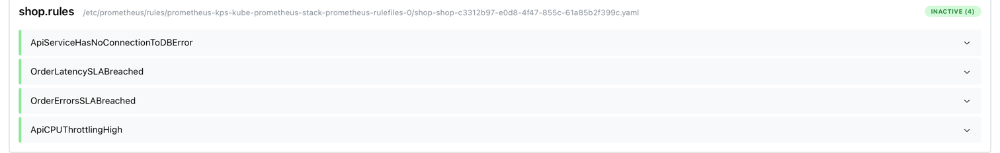

почему такие алерты:

+ p99 по /order - это прямое нарушение sla по задержке. окно 5 минут, как и в самом sla, порог 250ms лежит на границе бакета гистограммы, поэтому считается точно, а не интерполируется. severity warning - заказы создаются, просто медленнее, будить ночью не нужно. этот алерт про симптом и приходит раньше остальных, поэтому в первую очередь смотреть на троттлинг api и выселения на ноде
+ ошибки по /order - единственный critical, потому что это потерянные заказы. порог 1 процент, в baseline ошибок не было. 4xx считаются осознанно - sla сформулирован как доля не 2xx, но из-за этого кривой клиент тоже может разбудить дежурного, для sla лучше считать только 5xx
+ троттлинг api - первопричина хвоста задержки, которую нашли в части 8: при лимите квота кончается раньше конца периода CFS и запросы ждут. for 10m, чтобы не реагировать на короткие всплески. warning - это сигнал пересмотреть лимит и request api. похожий CPUThrottlingHigh есть и в kube-prometheus-stack, но он общий на все поды, а этот смотрит только на критический путь и с более строгим порогом

теперь провоцируем алерты - опускаю api request и limit по cpu до 10m при нагрузке 200 rps, api начинает троттлиться и p99 уходит за порог:

pending:

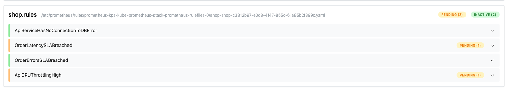

firing:

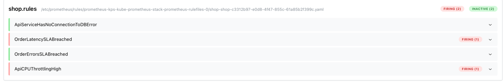


теперь делаем так, чтобы борда графаны подтягивалась из кода:

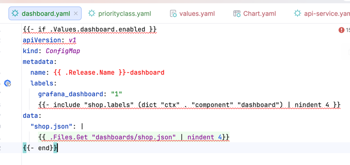

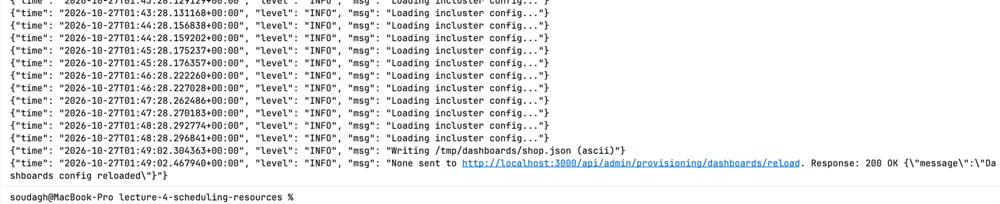

