# Лабораторная 5: zero-trust сеть


цель лабораторной доказать, что Service делает смерть подов невидимой для клиента, несмотря на то, что IP постоянно меняются. А также перевести shop из плоской сети "всё со всеми" в режиме "всё запрещено, кроме нужного". Это нужно будет подтвердить матрицей доступа и найти спрятанную поломку по карте трафика.

# Часть 0: выбор CNI

API-сервер только хранит и принимает NetworkPolicy, который сам по себе является объектом в etcd, но сам ничего не фильтрует. Для применения политики нужен CNI-плагин на каждой ноде. Дефолтный kindnet умеет только раздавать подам айпишники и прокладывать маршруты, а политики игнорирует.

По факту есть два кандидата, главное отличие между которыми - где происходит фильтрация:
+ Calico - программирует iptables, технология старая, предсказуемая и прозрачная
+ Cilium - вешает eBPF-программы на хуки ядра: на veth пода и на tc. Решение о фильтрации принимается по identity - числу, которое Cilium выводит из меток пода, а не по цепочке IP-правил. Также eBPF может отдавать события о каждом пакете, включая отброшенные, наружу.

по требованиям нам нужно находить поломку не подбором, а по карте трафика, следовательно, наш выбор падает на Cilium

# Часть 1: кластер, shop и сеть пода

## Кластер без kindnet

теперь нужен новый kind-кластер без kindnet, на который будет накатываться Cilium

Пересоздавать кластер нужно по той причине, что CNI выбирают при создании кластера: два плагина на одной ноде будут конфликтовать за `/etc/cni/net.d` и за маршруты. У уже запущенных подов сеть настроена kindnet'ом, и Cilium их не подхватит без пересоздания.

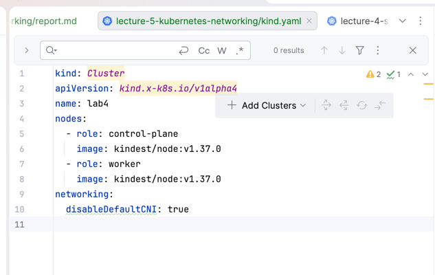

ноды сейчас в статусе NotReady, так как сеть не настроена до конца, из-за чего CoreDNS под находится в статусе Pending:

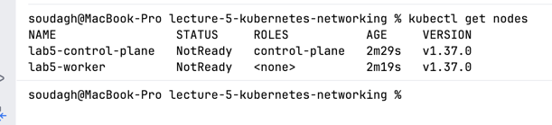

## Установка Cilium

`cilium-values.yaml`:

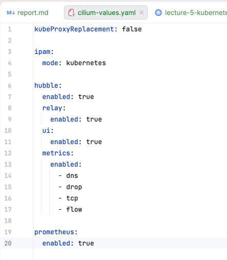

поды успешно поднялись

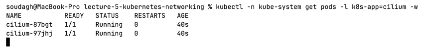

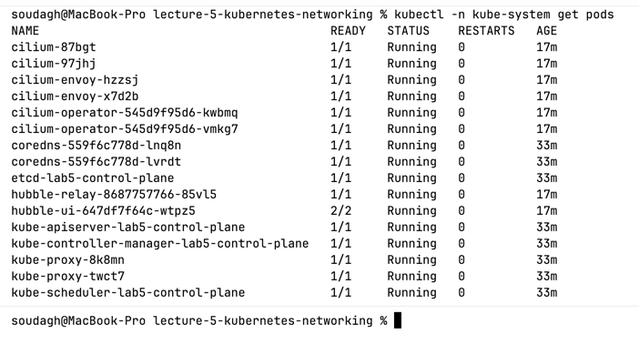

и ноды поднялись вместе с ними

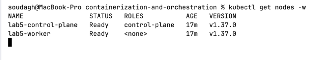

## Разворачивание shop

микроповтор 4 лабы для инфраструктуры:

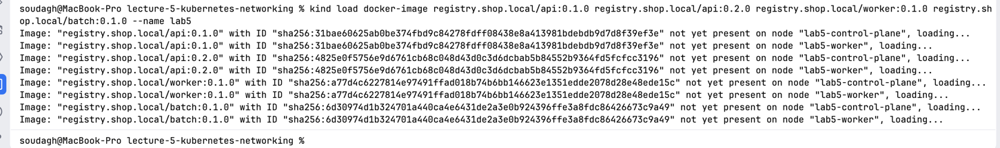

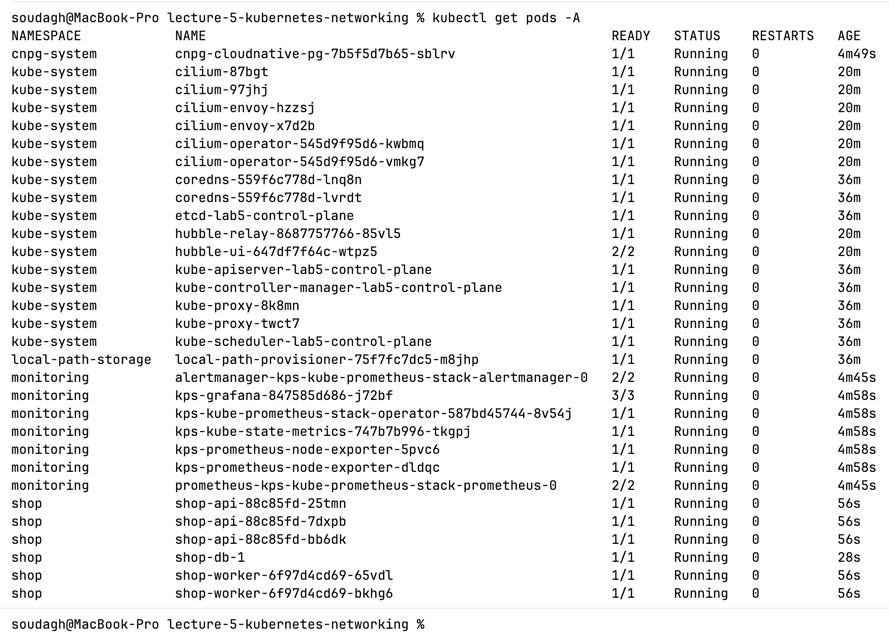

## Сеть пода изнутри

пройдём путь пакета: под -> его eth0 -> парный конец veth на ноде -> другая нода

так как образ api distroless, то нужен эфемерный дебаг-контейнер с сетевыми утилитами

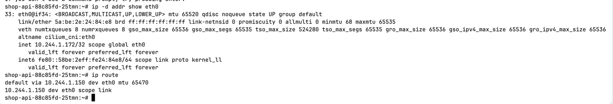

из скрина можем вытащить ifindex парного интерфейса в netns ноды - 34

также можно заметить, что маска /32 - под не считает себя частью подсети 10.244.1.0/24. Его сеть - он сам, следовательно, у него будто бы нет соседей, и каждый запрос уходит в gateway

Gateway 10.244.1.150 - айпи интерфейса cilium_host на ноде. Пакет не обязан физически дойти до cilium_host - пакет перехватывается сразу на входе в ноду и происходит решение, что с ним делать. Строка `10.244.1.150 dev eth0 scope link` делает его достижимым напрямую через eth0 - без этого при /32 до гейтвея дойти было бы нельзя

сам парный конец:

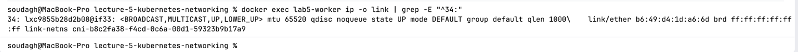

он указывает обратно на eth0 с номером 33, link-netns - на неймспейс пода
10.244.1.150 - адрес cilium_host - служебного интерфейса Cilium на ноде - наш гейтвей.
на lxc-интерфейс Cilium вешает eBPF-программу, и каждый пакет, который вышел из пода, сразу попадает в неё - здесь Cilium узнаёт identity отправителя и будет применять NetworkPolicy

теперь попытаемся из дебаг-контейнера на воркере обратиться к поду апи на control-plane напрямую по IP, без Service:

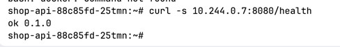

всё прошло успешно, если протрекать маршруты, то видим

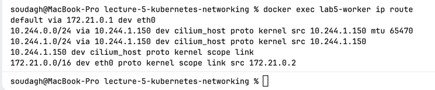

`10.244.0.0/24 via 10.244.1.150 dev cilium_host mtu 65470` - подсеть control-plane
`10.244.1.0/24 via 10.244.1.150 dev cilium_host` - своя подсеть
`172.21.0.0/16 dev eth0` - сеть между нодами

обе pod-подсети ядро отдаёт в cilium_host, то есть решение принимает eBPF Cilium
пакет 10.244.1.172 -> 10.244.0.7 предназначен поду на другой ноде, и eBPF заворачивает его в VXLAN через cilium_vxlan - внутри исходный пакет как есть, снаружи UDP 172.21.0.2 -> 172.21.0.3 с портом 8472
cilium_vxlan находится в режиме external - адрес ноды-получателя и VNI задаются для каждого пакета, в VNI кладётся identity отправителя.
mtu 65470 = 65520 − 50 - столько места занимают заголовки обёртки

на ноде-получателе - control-plane принимает UDP на 8472, снимает VXLAN, читает identity отправителя из VNI. Дальше eBPF доставляет исходный пакет в lxc-интерфейс пода 10.244.0.7, и он выходит из eth0 внутри пода.

таким образом под-получатель видит настоящий айпи отправителя без нат. Для подов это прямая связь по айпи, хотя по факту пакет ехал в туннеле.

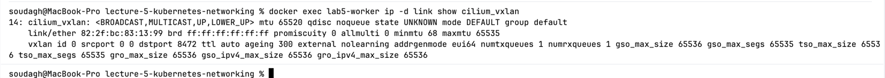

# Часть 2: непрерывность при хаосе подов

Теперь нужно доказать, что клиент обращается к апи по имени, а под капотом поды будут непрерывно умирать и появляться с новыми айпишниками, при этом клиент не будет терять ни одного запроса.

## NodePort

для начала нужно сделать тип Service у апи настраиваемым через values:

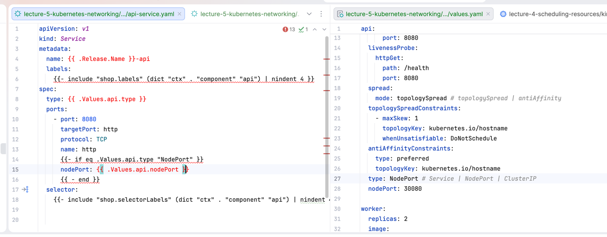

проверяем доступность:

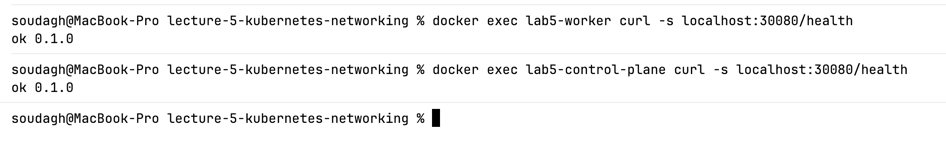

порт 30080 на ноде никто не слушает - kube-proxy на каждой ноде записывает в ядро NAT-правила, и пакет на любой IP ноды и порт 30080 ещё до маршрутизации проходит цепочку KUBE-NODEPORTS -> KUBE-EXT -> KUBE-SVC, где случайно выбирается под и делается DNAT на его IP. поэтому NodePort отвечает на каждой ноде, даже там, где подов api нет. если под на другой ноде, нода ещё и делает SNAT в свой адрес, чтобы ответ вернулся через неё же и прошёл обратный DNAT - цена в том, что под видит IP ноды, а не клиента. externalTrafficPolicy: Local отправляет только на поды этой же ноды, SNAT не нужен и IP клиента сохраняется, но нода без подов сбрасывает трафик, а нагрузка делится по нодам, а не по подам.

чем отличаются типы сервисов:
+ ClusterIP - виртуальный адрес внутри кластера, который kube-proxy через DNAT переводит в IP живых подов
+ NodePort - ClusterIP + порт на каждой ноде, тоже реализует kube-proxy
+ LoadBalancer - NodePort + внешний балансировщик, который создаёт cloud-controller-manager облака и направляет на NodePort нод. в kind облака нет, поэтому EXTERNAL-IP так и остался бы pending без MetalLB или cloud-provider-kind
+ headless, clusterIP: None - общего адреса нет, kube-proxy для него ничего не программирует, DNS отдаёт сразу IP всех подов, и какую реплику выбрать, решает сам клиент. нужно для StatefulSet и клиентской балансировки

## loadgen в чарте

теперь необходимо тестовый клиент поместить в чарт:

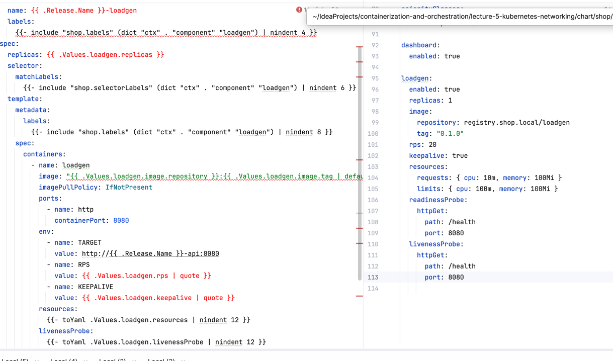

так как у клиента нет сервиса, то сервис-монитор не особо подходит для сбора метрик. Поэтому лучше использовать под-монитор - он выбирает поды напрямую по меткам, без сервиса

`podmonitor.yaml`
```
apiVersion: monitoring.coreos.com/v1
kind: PodMonitor
metadata:
  name: {{ .Release.Name  }}-loadgen
  labels:
    release: kps
    app.kubernetes.io/part-of: shop
spec:
  selector:
    matchLabels:
      app.kubernetes.io/name: loadgen
  podMetricsEndpoints:
    - port: http
      path: /metrics
      interval: 15s
```

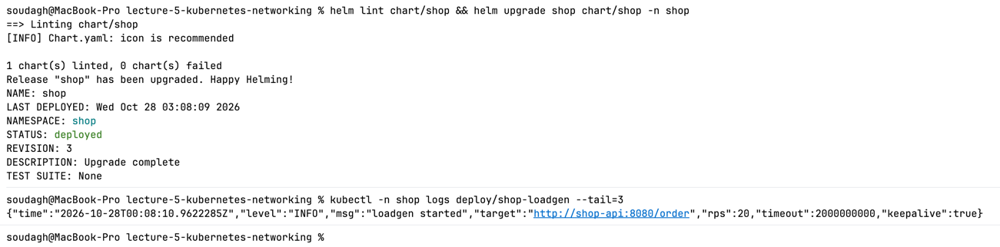

селектор специально только по app.kubernetes.io/name: loadgen - если выбирать все поды релиза по instance, PodMonitor подхватит ещё и api с worker, которые уже собирает ServiceMonitor, и в проме появятся дубли серий с разными job - суммы по http_requests_total удвоятся.


теперь надо написать скрипт - он раз в несколько секунд убивает случайный под апи или воркера.

`chaos.sh`
```
#!/usr/bin/env bash

set -euo pipefail

MODE="${MODE:-graceful}"
INTERVAL="${INTERVAL:-5}"
NAMESPACE="${NAMESPACE:-shop}"
SELECTOR='app.kubernetes.io/name in (api,worker)'

case "$MODE" in
  graceful) DELETE_ARGS=(--wait=false) ;;
  force)    DELETE_ARGS=(--wait=false --grace-period=0 --force) ;;
  *) echo "unknown MODE=$MODE (graceful|force)" >&2; exit 1 ;;
esac

echo "chaos: mode=$MODE interval=${INTERVAL}s namespace=$NAMESPACE, Ctrl+C to stop"
trap 'echo; echo "chaos: stopped"; exit 0' INT TERM

while true; do
  pods=()
  while IFS= read -r p; do pods+=("$p"); done < <(
    kubectl -n "$NAMESPACE" get pods -l "$SELECTOR" \
      -o jsonpath='{range .items[*]}{.metadata.deletionTimestamp}{"|"}{.metadata.name}{"|"}{.status.podIP}{"\n"}{end}' \
      | awk -F'|' '$1 == "" && $2 != "" {print $2 "|" $3}'
  )

  if [ "${#pods[@]}" -eq 0 ]; then
    echo "$(date '+%H:%M:%S') no running pods, waiting"
  else
    victim="${pods[RANDOM % ${#pods[@]}]}"
    name="${victim%%|*}"
    ip="${victim##*|}"
    kubectl -n "$NAMESPACE" delete pod "$name" "${DELETE_ARGS[@]}" >/dev/null 2>&1 || true
    echo "$(date '+%H:%M:%S') killed $name ($ip) mode=$MODE"
  fi

  sleep "$INTERVAL"
done
```

скрипт по дефолту раз в 5 секунд убивает случайный живой под апи или воркер в грейсфул режиме по умолчанию. Каждый снесённый под печатается в лог строкой со временем и айпи пода, чтобы сопоставить с графиком.

Теперь соберу панели в графане под скрипт:
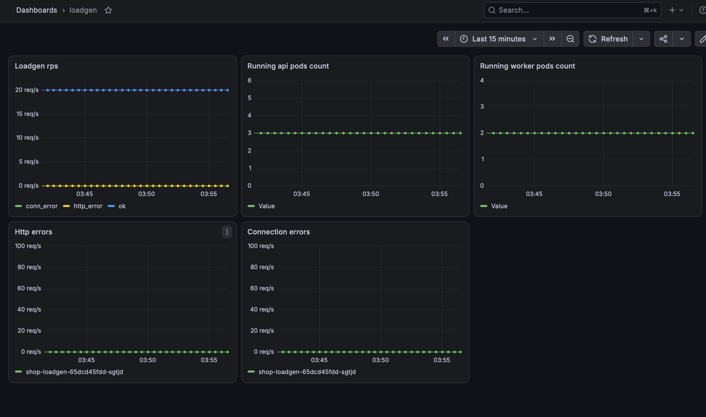

запускаю скрипт и даю ему поработать 5 минут

хвост работы скрипта:

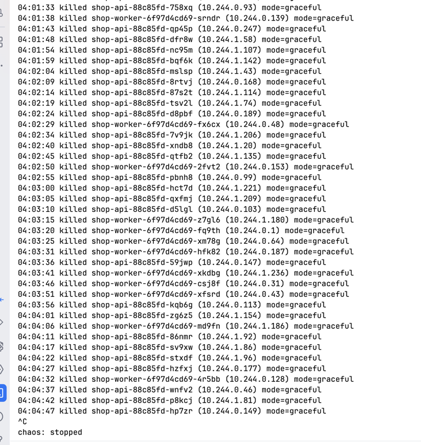

результаты работы:

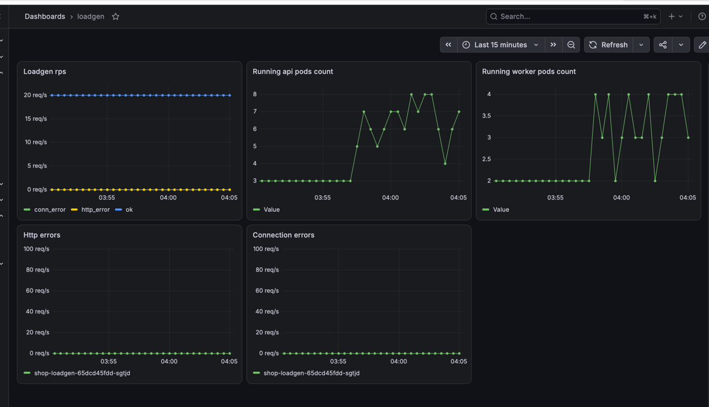

можно заметить, что шёл ровный поток ok 20 rps, не было ни одной ошибки, и количество уникальных айпи для апи и воркера выросли с 3 и 2 до 8 и 4 соответственно.

Всего сменилось 69 подов за 10 минут, и не было ни одной ошибки.

Теперь для сравнения я запущу скрипт в аварийном режиме, который убивает поды не в грейсфул режиме

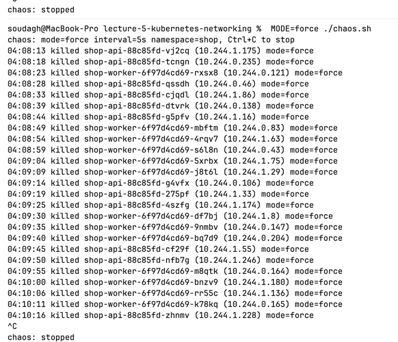

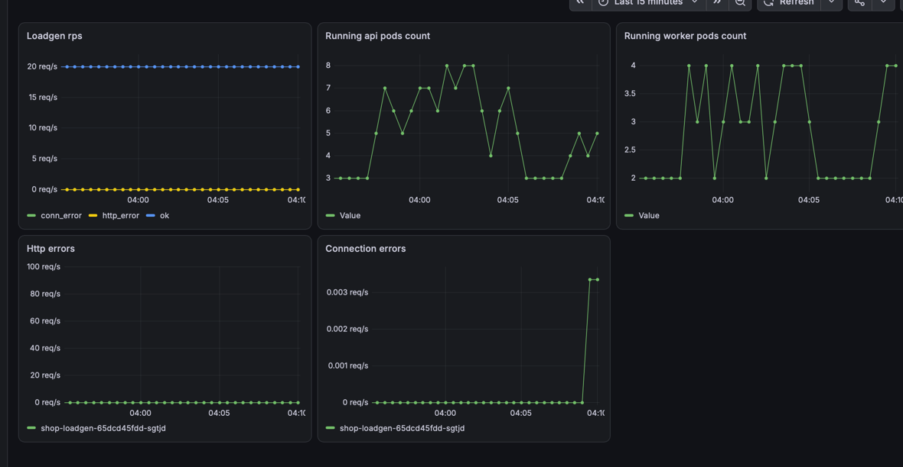

произошёл рост connection errors, соответствующий лог:

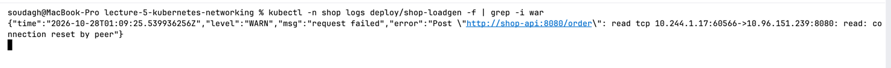

### почему клиент ничего не заметил

клиент обращается к shop-api по имени. kubelet пишет поду /etc/resolv.conf с search-доменами shop.svc.cluster.local, svc.cluster.local, cluster.local и ndots:5, поэтому короткое имя резолвер дополняет до shop-api.shop.svc.cluster.local и спрашивает CoreDNS. CoreDNS отвечает ClusterIP сервиса - виртуальный адрес, которого нет ни на одном интерфейсе. этот ответ не меняется, когда поды умирают, меняется только то, что за ним.

при graceful-shotdown под помечается terminating и сразу убирается из EndpointSlice, kube-proxy на всех нодах удаляет его из правил KUBE-SVC, и новые соединения на ClusterIP к нему больше не идут. в это время preStop sleep 5 держит процесс живым, он дообрабатывает уже пришедшие запросы, и только потом приходит SIGTERM. новый под через секунду становится Ready и попадает в EndpointSlice. поэтому при 69 сменах подов ни одного упавшего запроса.

в force-режиме объект удаляется из API сразу, контейнер получает SIGKILL одновременно с тем, как EndpointSlice начинает обновляться, и запрос, который в этот момент был внутри пода, рвётся - отсюда connection reset by peer. ошибка всего одна на ~7200 запросов, потому что число запросов inflight (тут я задумалась, как это нормльно перевести можно) = rps * время обработки, у нас 20 rps × ~3 мс = около 0.06 на весь сервис, и почти каждое убийство попадает в момент, когда под ничего не обрабатывает. при 2000 rps в полёте было бы примерно 6 запросов, и каждое убийство рвало бы пачку.

считаем это на стороне клиента, потому что метрики api видят только запросы, которые дошли до его обработчика - отказ соединения, обрыв посреди запроса или таймаут api не увидит, а счётчик убитого пода умирает вместе с ним.

### режим kube-proxy

```
$ kubectl -n kube-system get cm kube-proxy -o yaml | grep -E "^\s+mode:"
    mode: iptables
```

у нас iptables. правила лежат цепочками, каждое новое соединение проходит их последовательно, а при любом изменении endpoint'а kube-proxy переписывает таблицу целиком. на тысячах сервисов это десятки тысяч правил - растёт задержка первого пакета и время обновления, и окно, когда трафик ещё идёт на мёртвый IP, расширяется. IPVS хранит сервисы в хэш-таблицах ядра, поиск и обновление точечные +  можно выбрать алгоритм балансировки. у shop несколько сервисов и пара десятков правил, так что разница незаметна.


# Часть 3: матрица доступа на бумаге
Default-deny режет всё. Поэтому если сначала писать политики, а потом смотреть, что сломалось, это по факту является подбором. Матрица - список всех, кто реально ходит по сети в namespace shop, с портами и направлением.

Из очевидных участников:
+ клиент -> api
+ api -> postgres
+ worker -> postgres
+ посторонний под -> postgres - запрет

Неочевидные нужно будет найти. Для этого нам поможет Hubble - пока политик нет, всё разрешено, и Hubble видит каждый поток.

Если смотреть в UI, видим такую картину:

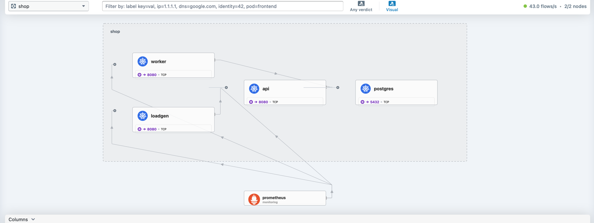

также есть поток с датой:

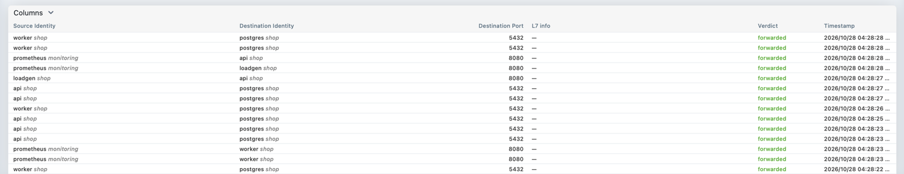


в таблице только инициаторы соединений - кто открывает соединение, кому и на какой порт назначения. ответы по уже открытому соединению отдельно не пишем: Cilium ведёт conntrack, и если соединение разрешено, ответы по нему проходят сами. порты вида 40702 или 59060 в потоках hubble - эфемерные порты клиента, а числа вида ID:9014 - identity пода, не порт.

каждая разрешённая строка - это egress у отправителя и ingress у получателя, если обе стороны под default-deny.

| откуда | куда | порт | можно? | egress у | ingress у | зачем |
|---|---|---|---|---|---|---|
| loadgen | api | 8080/TCP | да | loadgen | api | клиент создаёт заказы |
| внешний клиент через NodePort 30080, приходит с ноды | api | 8080/TCP | да | - | api | точка входа снаружи |
| api | postgres shop-db-1 | 5432/TCP | да | api | postgres | запись и чтение заказов |
| worker | postgres shop-db-1 | 5432/TCP | да | worker | postgres | фоновая обработка заказов |
| все поды shop | coredns в kube-system | 53/UDP и 53/TCP | да | все поды shop | - | резолв имён сервисов |
| prometheus из monitoring | api, worker, loadgen | 8080/TCP | да | - | api, worker, loadgen | сбор /metrics |
| оператор CNPG из cnpg-system | postgres shop-db-1 | 8000/TCP и 5432/TCP | да | - | postgres | статус инстанса и управление базой |
| postgres shop-db-1 | kube-apiserver 172.21.0.3 | 6443/TCP | да | postgres | - | instance manager CNPG читает и обновляет статус Cluster |
| kubelet с ноды, cilium_host 10.244.x.150 | api, worker, loadgen, postgres | 8080, 8000/TCP | да | - | все поды shop | readiness и liveness пробы |
| посторонний под | postgres shop-db-1 | 5432/TCP | нет | - | postgres | к базе ходят только api и worker |
| посторонний под | api | 8080/TCP | нет | - | api | api принимает только клиента, prometheus и пробы |
| api | worker | любой | нет | - | worker | им не нужно общаться напрямую, вся связь через базу |
| worker, loadgen | что-либо кроме перечисленного | любой | нет | worker, loadgen | - | лишний egress закрыт |

апи-сервер виден в потоках как адрес ноды 172.21.0.3:6443, а не ClusterIP 10.96.0.1:443 - Cilium видит пакет уже после DNAT kube-proxy

# Часть 4: NetworkPolicy в чарте

на основе матрицы выше был сформирован базовый минимум NetworkPolicy

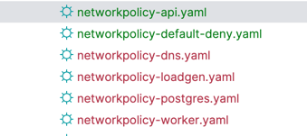

Network Policy для postgres:
```
{{- if .Values.networkPolicy.enabled }}
{{- $np := .Values.networkPolicy }}
apiVersion: networking.k8s.io/v1
kind: NetworkPolicy
metadata:
  name: {{ .Release.Name }}-postgres
  labels:
    {{- include "shop.labels" (dict "ctx" . "component" "postgres") | nindent 4 }}
spec:
  podSelector:
    matchLabels:
      app.kubernetes.io/name: postgres
  policyTypes:
    - Ingress
  ingress:
    - from:
        - podSelector:
            matchLabels:
              {{- include "shop.selectorLabels" (dict "ctx" . "component" "api") | nindent 14 }}
        - podSelector:
            matchLabels:
              {{- include "shop.selectorLabels" (dict "ctx" . "component" "worker") | nindent 14 }}
      ports:
        - port: {{ $np.ports.postgres }}
          protocol: TCP
    - from:
        - namespaceSelector:
            matchLabels:
              kubernetes.io/metadata.name: {{ $np.cnpgOperator.namespace }}
          podSelector:
            matchLabels:
              {{- toYaml $np.cnpgOperator.podLabels | nindent 14 }}
      ports:
        - port: {{ $np.ports.postgres }}
          protocol: TCP
        - port: {{ $np.ports.postgresStatus }}
          protocol: TCP
---
apiVersion: cilium.io/v2
kind: CiliumNetworkPolicy
metadata:
  name: {{ .Release.Name }}-postgres-apiserver
  labels:
    {{- include "shop.labels" (dict "ctx" . "component" "postgres") | nindent 4 }}
spec:
  endpointSelector:
    matchLabels:
      app.kubernetes.io/name: postgres
  egress:
    - toEntities: [kube-apiserver]
      toPorts:
        - ports:
            - port: "6443"
              protocol: TCP
{{- end }}
```
получаем 7 правил, как и должно быть

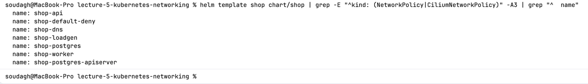

после раскатки все политики подтянулись

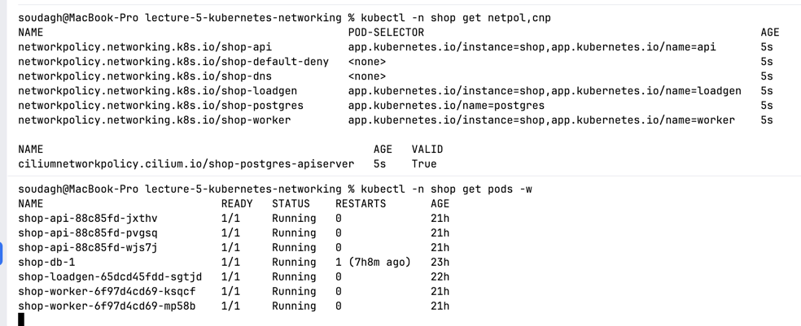

теперь наблюдаем две-три минуты - ищем connection errors в графане и dropped в hubble - вдруг, что-то забыли указать.

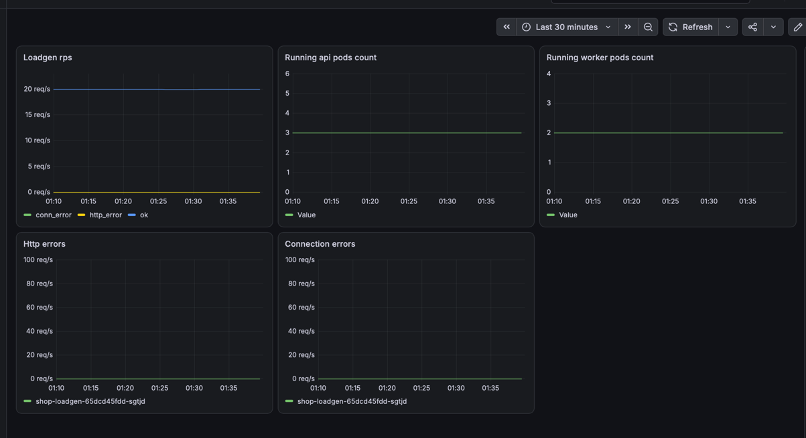

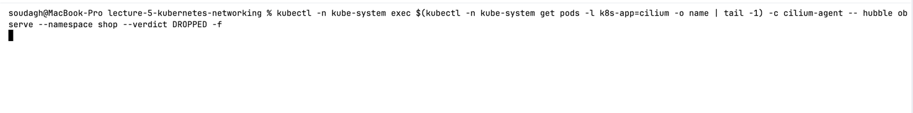

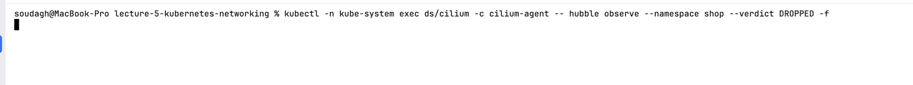

ошибок нет. Но стоит заметить, что пробы kubelet прошли без правил в политиках - Cilium по умолчанию пропускает трафик от host к подам своей ноды.

# Часть 5: проверка матрицы вживую
Теперь пробуем реально соединиться и проверить, что всё работает ровно так, как мы ожидаем. Для этого будет написан скрипт matrix.sh, который будет прогонять все проверки через `nc -w 2`

как проверяем:
+ от имени api, worker и loadgen - через эфемерный debug-контейнер в их поде. у него та же identity в Cilium, значит, на него действуют те же политики, и проверка честная
+ посторонний - отдельный под outsider в namespace shop без меток shop. на него действуют только default-deny и DNS-политика, потому что podSelector: {} выбирает и его
+ NodePort - curl с kind-нод, по 10 попыток

результат:

| # | откуда | куда | ожидаемо | фактически | |
|---|---|---|---|---|---|
| 1 | loadgen | api:8080 | проходит | проходит | ✅ |
| 2 | api | postgres:5432 | проходит | проходит | ✅ |
| 3 | worker | postgres:5432 | проходит | проходит | ✅ |
| 4 | api | DNS shop-db-rw | проходит | проходит | ✅ |
| 5 | outsider | postgres:5432 | закрыто | закрыто | ✅ |
| 6 | outsider | api:8080 | закрыто | закрыто | ✅ |
| 7 | outsider | DNS shop-db-rw | проходит | проходит | ✅ |
| 8 | api | worker:8080 | закрыто | закрыто | ✅ |
| 9 | loadgen | postgres:5432 | закрыто | закрыто | ✅ |
| 10 | worker | api:8080 | закрыто | закрыто | ✅ |
| 11 | api | 1.1.1.1:443 | закрыто | закрыто | ✅ |
| 12 | нода worker | NodePort localhost:30080 | проходит | 7 из 10, после фикса 10 из 10 | ✅ |
| 13 | нода control-plane | NodePort ноды worker | проходит | 0 из 10, после фикса 10 из 10 | ✅ |

все внутренние маршруты совпали с матрицей: разрешённое работает, запрещённое не проходит. посторонний под не может подключиться ни к postgres, ни к api, но DNS у него работает - DNS-политика выбирает все поды namespace.

а вот NodePort нашёл дыру в самой матрице - по ней внешний клиент через NodePort должен доходить до api, а фактически с ноды worker проходит 7 попыток из 10, а с соседней ноды ни одной. в Hubble видно, что отбрасывается:

```
10.244.1.150:39776 (world) <> shop/shop-api-88c85fd-pvgsq:8080 (ID:42157) policy-verdict:none INGRESS DENIED (TCP Flags: SYN)
10.244.1.150:39776 (world) <> shop/shop-api-88c85fd-pvgsq:8080 (ID:42157) Policy denied DROPPED (TCP Flags: SYN)
```

раскладка подов api в этот момент: два пода на lab5-worker и один - shop-api-88c85fd-pvgsq - на lab5-control-plane.
Соответственно, те запросы, которые уходили на ноду control-plane у нас валились, так как после SNAT источник становится адресом ноды worker, а на control-plane этот адрес никому не принадлежит, и пакет отбрасывается.

Следовательно, нужно разрешить ingress в api на 8080 для внешнего клиента и при этом не открыть его для outsider - я выберу вариант реализации через CiliumNetworkPolicy, так как fromEntities выбирает по identity, а не по айпи. Если выбрать реализацию через статический ipBlock, то мы оставим поведение с айпи подов на усмотрение CNI - в каком-то плагине отработает, как нам надо, в каком-то нет, то есть правило, корректность которого зависит от реализации

```
{{- if .Values.networkPolicy.enabled }}
{{- $np := .Values.networkPolicy }}
apiVersion: cilium.io/v2
kind: CiliumNetworkPolicy
metadata:
  name: {{ .Release.Name }}-api-external
  labels:
    {{- include "shop.labels" (dict "ctx" . "component" "api") | nindent 4 }}
spec:
  endpointSelector:
    matchLabels:
      {{- include "shop.selectorLabels" (dict "ctx" . "component" "api") | nindent 6 }}
  ingress:
    - fromEntities:
        {{- toYaml $np.externalEntities | nindent 8 }}
      toPorts:
        - ports:
            - port: {{ $np.ports.app | quote }}
              protocol: TCP
{{- end }}

```


результат после фикса:

| # | откуда | куда | ожидаемо | фактически | |
|---|---|---|---|---|---|
| 1 | loadgen | api:8080 | проходит | проходит | ✅ |
| 2 | api | postgres:5432 | проходит | проходит | ✅ |
| 3 | worker | postgres:5432 | проходит | проходит | ✅ |
| 4 | api | DNS shop-db-rw | проходит | проходит | ✅ |
| 5 | outsider | postgres:5432 | закрыто | закрыто | ✅ |
| 6 | outsider | api:8080 | закрыто | закрыто | ✅ |
| 7 | outsider | DNS shop-db-rw | проходит | проходит | ✅ |
| 8 | api | worker:8080 | закрыто | закрыто | ✅ |
| 9 | loadgen | postgres:5432 | закрыто | закрыто | ✅ |
| 10 | worker | api:8080 | закрыто | закрыто | ✅ |
| 11 | api | 1.1.1.1:443 | закрыто | закрыто | ✅ |
| 12 | нода worker | NodePort localhost:30080 | 10 из 10 | 10 из 10 | ✅ |
| 13 | нода control-plane | NodePort ноды worker | 10 из 10 | 10 из 10 | ✅ |

# Часть 6: скрытая поломка
Теперь попытаемся диагностировать проблему - есть только понимание того, что заказы не проходят, а что именно сломано - неизвестно. Соответственно попытаемся найти причину по карте трафика

Для этого будет подготовлено несколько вариантов поломок и скрипт, который выбирает рандомный вариант и применяет. Далее я буду искать причину через Hubble, чиню и подтверждаю результат.

итак, начнём:
прописала в консоль `./break.sh`
перво наперво иду смотреть в графану:

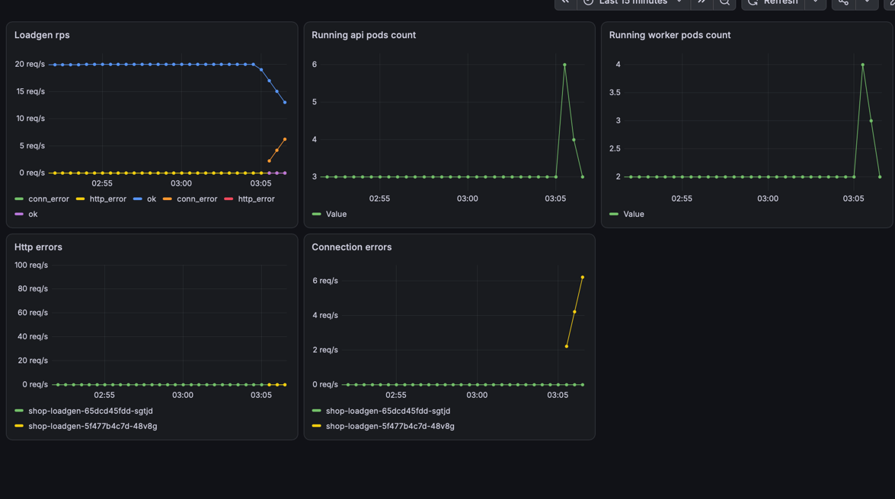

вижу кратковременный всплеск connection errors, падение суммарного количества подов api и worker, а также часть трафика loadgen начала падать как раз с connection error. Сначала подумала, что сломано между клиентом и api, но в логе loadgen ошибка Client.Timeout exceeded while awaiting headers - соединение с api установилось, а ответа не дождались за 2 секунды. значит api жив, а проблема дальше по цепочке. отличать помогает текст ошибки: connection refused или no such host - рядом с клиентом, таймаут ожидания ответа - дальше.
Посмотрим логи api:

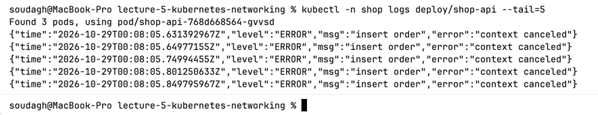

Неудачная вставка заказа. Следовательно, можем предположить, что проблема заключается в связи api с бд

Теперь смотрим Hubble:

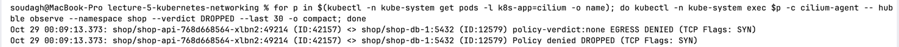

Видим, что по политике egress в бд не проходит. Следовательно, ошибка может быть там. Смотрим в конфигурацию:

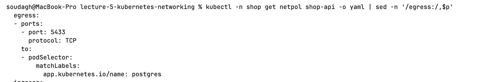

Видим, что порт постгрес 5433, а не 5432 - проблема заключалась ровно в этом

Смотрим ответ через скрипт:

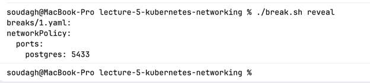

Всё подтвердилось! Мне удалось оттрекать проблему по тем артефактам, что были.


что стоит отметить из диагностики:
+ порт 5433 стоял и в egress у api, и в ingress у postgres, но Hubble показал EGRESS DENIED на стороне api - политика проверяется сначала на lxc отправителя, пакет умер там и до ingress базы не доехал. место дропа сразу говорит, чья политика виновата
+ клиент получил таймаут, а не мгновенную ошибку, потому что Cilium отбрасывает SYN молча, без RST и ICMP. TCP-стек api повторяет SYN с нарастающей паузой, и соединение висит до таймаута. на закрытом порту ядро сразу ответило бы RST, и был бы мгновенный connection refused. зависание и таймаут - почерк того, что по пути кто-то молча глотает пакеты
+ политики показывают только намерение - что разрешено, матрица показывает симптом - какой маршрут не работает. Hubble показал факт - конкретный пакет api -> shop-db-1:5432 отброшен на egress api, ни одно правило не совпало. из одной строки понятно, какую политику открыть и с каким портом сравнивать, без него пришлось бы перебирать политики и values

# Часть 7: мониторинг

Теперь нужны метрики соединений, отклонённого политиками трафика и DNS

сейчас есть проблема, что агент Hubble отдаёт достаточно бесполезные метрики - в них нет контекста: нет ни namespace, ни пода, ни направления. Следовательно, мы не сможем отличить два случая - outsider бьётся в базу, и апи не может достучаться до базы. Если первый случай, согласно нашей политике, не проходит, то второй означает, что наша политика сломана.

Исправленный блок hubble:
```
hubble:
  enabled: true
  relay:
    enabled: true
  ui:
    enabled: true
  metrics:
    enabled:
      - "dns:sourceContext=workload-name|pod-name|reserved-identity;labelsContext=source_namespace"
      - "drop:sourceContext=workload-name|pod-name|reserved-identity;destinationContext=workload-name|pod-name|reserved-identity;labelsContext=source_namespace,destination_namespace"
      - "tcp:sourceContext=workload-name|pod-name|reserved-identity;destinationContext=workload-name|pod-name|reserved-identity;labelsContext=source_namespace"
      - "flow:sourceContext=workload-name|pod-name|reserved-identity;destinationContext=workload-name|pod-name|reserved-identity;labelsContext=source_namespace,destination_namespace"
```

sourceContext и destinationContext задают, какой меткой подписать источник и получателя, labelsContext добавляет отдельные метки namespace. workload-name - имя Deployment, оно стабильно. pod-name стоит только запасным вариантом после него: если поставить его первым, каждый пересозданный под давал бы новые серии в проме - кардинальность растёт, и серии мёртвых подов будут висеть мусором. pod-name изначально в этом перечне отсутствовал, но был добавлен из-за базы, это ниже. агент читает конфиг только при старте, поэтому после helm upgrade нужен rollout restart ds/cilium.

После рестарта агента видим, что лейблы подтянулись

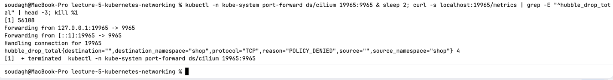

ServiceMonitor для Hubble:
```
{{- if .Values.hubbleMetrics.enabled }}
{{- $h := .Values.hubbleMetrics }}
apiVersion: monitoring.coreos.com/v1
kind: ServiceMonitor
metadata:
  name: {{ .Release.Name }}-hubble
  labels:
    release: kps
    app.kubernetes.io/part-of: shop
spec:
  namespaceSelector:
    matchNames:
      - {{ $h.namespace }}
  selector:
    matchLabels:
      {{- toYaml $h.serviceLabels | nindent 6 }}
  endpoints:
    - port: {{ $h.port }}
      interval: {{ $h.interval }}
{{- end }}
```

Пром начал собирать метрики, но проблема в том, что метрики `hubble_dns_*` нет. метрики DNS Hubble строит из разобранных DNS-запросов, а разбирает их только DNS-прокси Cilium, который включается L7-правилом для DNS в CiliumNetworkPolicy. обычная NetworkPolicy на 53 порт только пропускает пакеты, внутрь Cilium не смотрит.

был и второй вариант - метрики самого CoreDNS, kps их и так собирает. но это метрики сервера по всему кластеру - по ним не видно, что проблемы именно у shop, и не видно запросов, которые до CoreDNS вообще не дошли, а это ровно поломка DNS из breaks. поэтому DNS-политику переписала на CiliumNetworkPolicy:

```
apiVersion: cilium.io/v2
kind: CiliumNetworkPolicy
metadata:
  name: {{ .Release.Name }}-dns
spec:
  endpointSelector: {}
  egress:
    - toEndpoints:
        - matchLabels:
            k8s:io.kubernetes.pod.namespace: {{ $np.dns.namespace }}
            {{- range $k, $v := $np.dns.podLabels }}
            {{ $k }}: {{ $v }}
            {{- end }}
      toPorts:
        - ports:
            - port: {{ $np.dns.port | quote }}
              protocol: ANY
          rules:
            dns:
              - matchPattern: "*"
```

после этого появились hubble_dns_responses_total с кодами ответа. сразу видно, что Non-Existent Domain больше, чем No Error, хотя всё работает - это ndots:5, короткое имя резолвер сначала пробует со всеми search-доменами, и часть вариантов законно отвечает NXDOMAIN. поэтому алерт на NXDOMAIN горел бы всегда

Во время формирования списка алертов и бордов я заметила, что для метрики `hubble_drop_total` лейбл `destination` для бд `reserved:unknown`, что является непрозрачным значением. Проблема заключается в том, что CNPG не использует StatefulSet - оператор создаёт под напрямую, и его владелец - кастомный ресурс Cluster. Так как Cilium не знает такой ресурс, то и workload под него определить не может. Поэтому в цепочку добавлю запасной вариант pod-name. имя shop-db-1 стабильно - CNPG сохраняет его при пересоздании, так что серии не плодятся. у outsider то же самое - у него вообще нет владельца. после рестарта Cilium поды api и worker какое-то время тоже видны по имени пода, пока новый агент не прогрел информацию о владельцах, поэтому в алертах источник фильтруется регуляркой, а не точным равенством

Алерты:

| алерт | выражение | for | severity | почему                                                                                                                                                                                                                                   |
|---|---|---|---|------------------------------------------------------------------------------------------------------------------------------------------------------------------------------------------------------------------------------------------|
| ShopTrafficDeniedByPolicy | `sum by (source, destination, reason) (rate(hubble_drop_total{reason=~"POLICY_DENIED\|POLICY_DENY", source=~"shop-(api\|worker\|loadgen).*\|prometheus-.*\|reserved:host\|reserved:kube-apiserver\|coredns.*"}[5m])) > 0` | 1m | critical | политика режет ожидаемый трафик - любого легитимного участника матрицы: наших сервисов, prometheus, проб kubelet, kube-apiserver, coredns. это причина, по ней видно, кто и куда не может достучаться. outsider в список не входит - его дропы значат, что политика работает как надо, будить из-за этого никого не нужно, а на дашборде они видны                                                                                              |
| ShopDNSServerErrors | `sum by (rcode) (rate(hubble_dns_responses_total{source_namespace="shop", rcode!~"No Error\|Non-Existent Domain"}[5m])) > 0` | 5m | warning | DNS отвечает подам shop ошибками вроде SERVFAIL или REFUSED. NXDOMAIN не считаем - он есть всегда из-за ndots:5 и search-доменов, в норме его даже больше, чем успешных ответов. for 5m - одиночная ошибка при рестарте CoreDNS не повод |
| ShopClientRequestsFailing | `sum(rate(loadgen_requests_total{namespace="shop", result!="ok"}[2m])) / sum(rate(loadgen_requests_total{namespace="shop"}[2m])) > 0.05` | 2m | critical | больше 5 процентов запросов с клиента падает, заказы не оформляются. считаем на стороне клиента, потому что api не видит запросы, которые до него не дошли, это разбирали в части 2                                                      |

Алерты в проме:

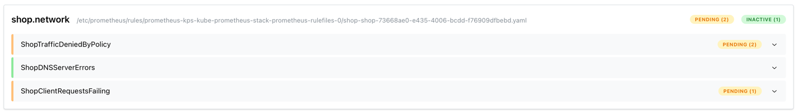

Загорелся

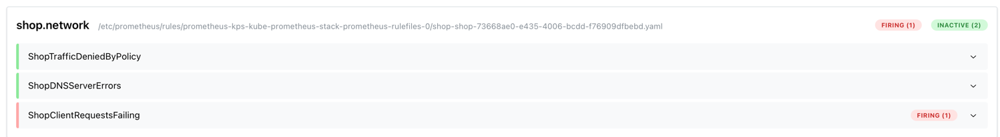

проблемы на борде:

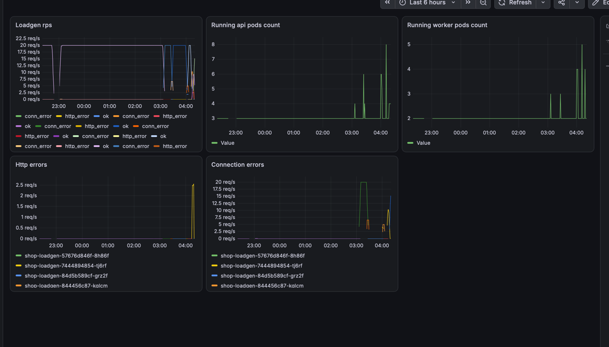

но, как видим, лейблов у этого алерта нет, а второй, основной, алерт не загорелся.

первая версия алерта была написана неправильно дважды.

во-первых, фильтр был только на `POLICY_DENIED` - ни одно правило не разрешило, то есть default-deny. А есть ещё и `POLICY_DENY` - сработало явное запрещающее правило.

во-вторых, источником были только сервисы shop. а при этой поломке политика отбрасывала входящий в api трафик от проб kubelet и от прома, поды api становились NotReady, EndpointSlice сервиса пустел, и kube-proxy сразу отвергал соединения на ClusterIP - клиент получал connection refused на своей же ноде, и его пакеты до политики api вообще не доходили. дропов от loadgen не было ни одного, хотя клиент лежал. поэтому источник расширен до всех легитимных участников матрицы.

вывод - алерт на причину может молчать, когда следствие уже есть, поэтому держим пару: ShopClientRequestsFailing говорит, что пользователю плохо, ShopTrafficDeniedByPolicy - почему.

После исправления:

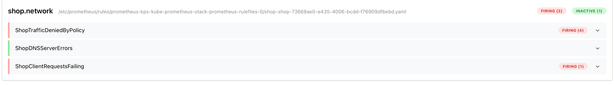

и лейблы появились:

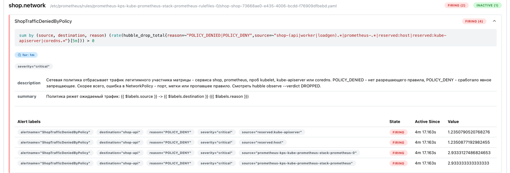

далее по традиции формируем заезд борды из кода.

```
{{- if .Values.dashboard.enabled }}
apiVersion: v1
kind: ConfigMap
metadata:
  name: {{ .Release.Name }}-dashboard
  labels:
    grafana_dashboard: "1"
    {{- include "shop.labels" (dict "ctx" . "component" "dashboard") | nindent 4 }}
data:
{{- range $path, $_ := .Files.Glob "dashboards/*.json" }}
  {{ base $path }}: |
    {{- $.Files.Get $path | nindent 4 }}
{{- end }}
{{- end }}

```

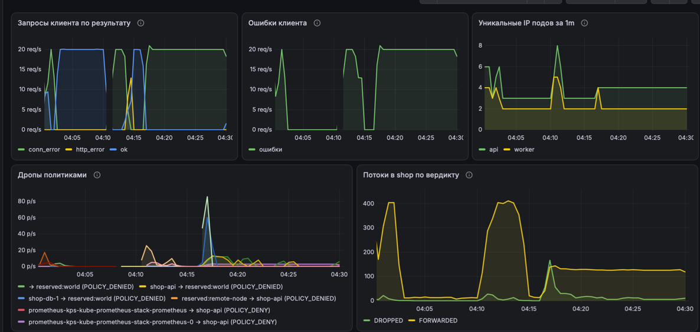


